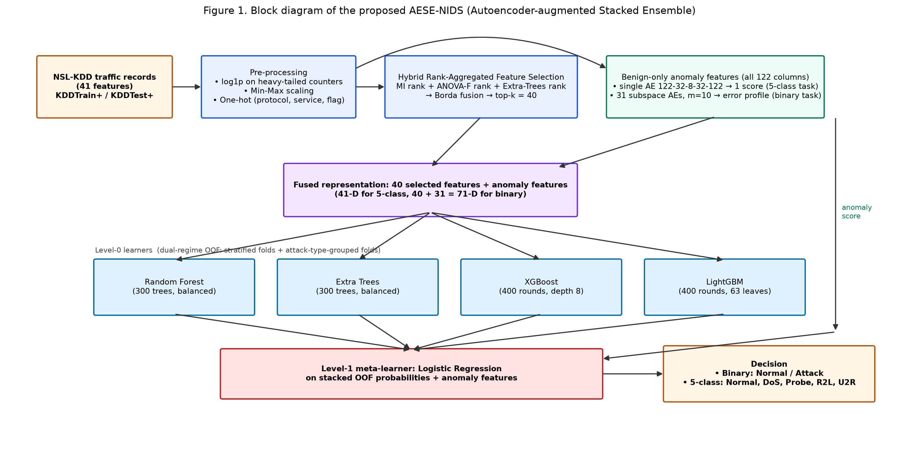

# Intelligent Network Intrusion Detection System Using Machine Learning

A complete, reproducible machine-learning project that detects network attacks from
connection records. It contains the code, the trained model, every experiment result,
every figure, and the full written report (Markdown and Word). This README explains the
project from zero: what the problem is, why it matters, what we built, why we built it
that way, what the results mean, and how to run everything yourself.

---

## Table of contents

1. [What is this project about?](#1-what-is-this-project-about)
2. [Why does it matter?](#2-why-does-it-matter)
3. [The dataset: NSL-KDD](#3-the-dataset-nsl-kdd)
4. [What we built: AESE-NIDS](#4-what-we-built-aese-nids)
5. [Why we built it this way (the story of the design)](#5-why-we-built-it-this-way)
6. [Project structure: what every file does](#6-project-structure)
7. [How to set up and run](#7-how-to-set-up-and-run)
8. [Results and how to read them](#8-results-and-how-to-read-them)
9. [The report](#9-the-report)
10. [Glossary](#10-glossary)
11. [Limitations and future work](#11-limitations-and-future-work)

---

## 1. What is this project about?

A **Network Intrusion Detection System (NIDS)** watches the traffic flowing through a
network and raises an alarm when something looks like an attack: a denial-of-service
flood, a port scan, a password-guessing attempt, a privilege-escalation exploit.

Traditional NIDS products (Snort, Suricata) work with **signatures**: hand-written rules
that describe a known attack. They are precise, but they cannot see an attack nobody has
written a rule for yet.

This project builds an **intelligent** NIDS: instead of rules, a machine-learning model
learns from labelled examples what normal and malicious connections look like, and then
classifies new connections on its own. We solve two tasks:

| Task | Question answered | Output |
|---|---|---|
| **Binary** | Is this connection an attack? | Normal / Attack |
| **5-class** | What kind of attack is it? | Normal, DoS, Probe, R2L, U2R |

The project was done for the course assignment "Intelligent Network Intrusion Detection
System Using Machine Learning", which required (Task 1) a literature-based report and
(Task 2) a **new algorithm**, its implementation, results, and comparison with prior work.

---

## 2. Why does it matter?

- **Signatures miss new attacks.** A zero-day exploit or a slightly mutated malware
  sample produces no signature match.
- **Traffic volume is huge.** Rules are slow to maintain and evaluate at scale; a model
  classifies a record in microseconds.
- **Published ML detectors overfit.** Many papers report 99%+ accuracy, but on the
  *official* NSL-KDD test split (which contains attack types absent from training) the same
  models drop to 75–82%. A detector that only recognises what it was trained on is just a
  learned signature database.

The real research question of this project is therefore not "can we get high accuracy on
data like the training data" (easy) but **"can we keep useful accuracy on attacks the model
has never seen"** (hard). Everything in the design is aimed at that.

---

## 3. The dataset: NSL-KDD

NSL-KDD is the standard benchmark for this problem (Tavallaee et al., 2009). It is a cleaned
version of the KDD Cup 1999 data with duplicates removed. Files are in `data/raw/`.

| | KDDTrain+ (train) | KDDTest+ (test) |
|---|---|---|
| Records | 125,973 | 22,544 |
| Normal | 67,343 | 9,711 |
| DoS (denial of service) | 45,927 | 7,460 |
| Probe (scanning) | 11,656 | 2,421 |
| R2L (remote-to-local, e.g. password guessing) | 995 | 2,885 |
| U2R (user-to-root, e.g. buffer overflow) | 52 | 67 |

Each record = one TCP/IP connection described by **41 features**:

- *basic*: duration, protocol, service, flag, bytes sent/received …
- *content*: failed logins, root shell obtained, files created …
- *time-based traffic*: number of connections to the same host/service in the last 2 s and
  their error rates …
- *host-based traffic*: same statistics over the last 100 connections.

Two things make the test set hard, and they are the whole point of the benchmark:

1. **17 attack types appear only in the test set** (apache2, mscan, snmpguess, xterm, …) —
   3,750 records the model can only catch by *generalising*.
2. **R2L is 3× more common in test than in train** and U2R has only 52 training examples.

---

## 4. What we built: AESE-NIDS

**AESE-NIDS = Autoencoder-augmented Stacked Ensemble for Network Intrusion Detection.**

The current version (v2) was reached in two rounds: a first design, then a reading of
three papers and a set of logged experiments that changed one component. That whole
path, with the dead ends, is written up in
[`experiments/RESEARCH_NOTES.md`](experiments/RESEARCH_NOTES.md); every experiment row is
in [`experiments/results.csv`](experiments/results.csv).



The pipeline has four stages. Everything is *fitted on the training set only*; the test
set is touched once, at the end, for evaluation.

### Stage 1 – Pre-processing (`src/preprocessing.py`)
- One-hot encode the 3 categorical columns (protocol, service, flag) → 122 columns total.
- `log(1 + x)` on 16 heavy-tailed counters (e.g. `src_bytes` spans 9 orders of magnitude).
- Min-max scale every column to [0, 1] using training-set min/max.

### Stage 2 – HRA-FS: Hybrid Rank-Aggregated Feature Selection (`src/feature_selection.py`)
Three different "how useful is this feature?" scores are computed:

| View | What it captures | Known weakness |
|---|---|---|
| Mutual information | any non-linear dependence | noisy on sparse one-hot columns |
| ANOVA F-statistic | separation of class means | linear only |
| Extra-Trees importance | feature interactions | biased to high-cardinality columns |

Each produces a ranking; the three rankings are fused with a **Borda count** (a voting
rule). A feature must be good under *several* views to survive. The top **40** of 122 are
kept. This removes noise and one-view bias while losing no accuracy (see ablation).

### Stage 3 – Anomaly features from benign-only autoencoders
Two variants, both trained **only on benign training records**, so they need no attack
examples at all:

- **Single autoencoder** (`src/autoencoder.py`, used for the 5-class task): a 122 → 32 → 8
  → 32 → 122 network trained to reconstruct its input. Its 8-neuron bottleneck can only
  memorise what normal traffic has in common, so anything unusual reconstructs badly. The
  per-record reconstruction error, scaled to [0, 1], is appended as a 41st feature.
- **Subspace anomaly profile** (`src/subspace_autoencoder.py`, used for the binary task,
  added in v2 after reading Mirsky et al.'s Kitsune paper): the 122 columns are clustered
  by correlation into 31 groups of at most 10 features (SYN-error features end up
  together, port-scan error flags together, shell/root-access counters together, …). One
  tiny autoencoder per group gives a per-group reconstruction error, so instead of one
  "how weird is this record" number the classifier gets a 31-dim vector saying *which part*
  of the connection is abnormal. `results/figures/fig_subspace_profile.png` shows the mean
  profile per class.

### Stage 4 – Novelty-aware stacked ensemble (`src/models.py`, class `NoveltyAwareStacking`)
Four strong but *different* tree models are trained as level-0 learners:
Random Forest, Extra Trees, XGBoost, LightGBM.
A logistic-regression **meta-learner** then learns how to combine their probability
outputs *plus the anomaly score* into one decision.

The new idea is **how the meta-learner's training data is made** (see Section 5).

---

## 5. Why we built it this way

This section is the honest story of the design, including what did *not* work, because
it explains every choice.

**Step 1 – first attempt: standard stacking + anomaly feature.**
We trained the four tree models, stacked them with ordinary 5-fold cross-validated
predictions, and added the autoencoder score as a feature. Result on KDDTest+:

| Model | Binary accuracy | Detection rate |
|---|---|---|
| XGBoost alone | 81.0 % | 68.7 % |
| Stacked ensemble + AE feature (standard folds) | 80.1 % | 67.1 % |
| **Autoencoder alone (unsupervised!)** | **85.8 %** | **81.8 %** |

The unsupervised autoencoder beat every supervised model, and the ensemble *ignored* it
(the meta-learner gave the anomaly score a weight of 0.98, essentially nothing).

**Why?** With ordinary folds, the base learners have seen every attack type during
training, so their out-of-fold predictions are ~99.8 % correct. The meta-learner sees
learners that are never wrong, learns to copy them, and never discovers that the anomaly
score is useful. On the test set the learners *are* wrong (on the 17 unseen attack types)
but the meta-learner has no rule for that situation.

**Step 2 – the fix: novelty-aware (dual-regime) stacking.**
We generate the meta-learner's training rows in **two regimes**:

1. *Familiar regime* – ordinary stratified 5-fold out-of-fold predictions
   (shows how learners behave on traffic they know).
2. *Novel regime* – every **attack type** is assigned to exactly one fold. When that fold
   is held out, the learners are trained **without ever seeing those attack types**, so
   their predictions on it are what they would produce for a zero-day attack.

Both sets of rows (2 × 125,973) train the meta-learner. It now sees cases where the base
learners are confidently wrong and the anomaly score is high, and learns the rule
*"when the learners agree, follow them; when they hesitate, trust the anomaly score"*.
The anomaly-score weight jumped from 0.98 to ≈10 and test accuracy rose by 3–5 points.

**Step 3 – autoencoder on all 122 columns, not the 40 selected ones.**
Feature selection keeps columns that separate the *known* classes. The autoencoder's job
is different: describe what *normal* looks like. A column useless for DoS-vs-Probe can still
signal abnormality. Tested on a 40 k subsample: 84.8 % (122 columns) vs 83.0 % (40 columns).

**Step 4 – reading papers and running experiments (v2).**
With v1 written up I read three papers properly (Tavallaee 2009, the NSL-KDD dataset
paper; Shone 2018, stacked non-symmetric autoencoders + RF; Mirsky 2018, Kitsune) and
turned each into an experiment (`experiments/run_experiments.py`, results in
`experiments/results.csv`, discussion in `experiments/RESEARCH_NOTES.md`):

| Idea | From | Binary acc | Unseen-attack DR | 5-class acc | Kept? |
|---|---|---|---|---|---|
| v1 baseline | – | 84.11 | 64.85 | 78.52 | 5-class only |
| Score on the hard KDDTest-21 subset too | Tavallaee | 70.01 (Test-21) | – | 59.68 (Test-21) | yes, reported |
| Add the AE bottleneck code as features | Shone | 84.94 | 70.37 | 76.02 | no |
| KitNET output score instead of AE score | Mirsky | 85.61 | 73.31 | 77.78 | no |
| **31 subspace RMSEs as meta-features** | Mirsky | **86.52** | **79.63** | 76.84 | **yes, binary** |
| Subspace RMSEs + old AE score | both | 85.34 | 72.16 | 77.33 | no |
| Subspace size m = 5 / 20 | Mirsky | 83.71 / 86.57 | 63.89 / 79.57 | – | m = 10 kept |

Lessons: the structured anomaly vector is a much better signal for the binary detector
than a single score (+15 points on never-seen attack types), but it hurts the rare
families in the 5-class task, so the two tasks use different anomaly inputs. The
Kitsune model *alone* is a weak detector on this data (66.5 %); it is the combination with
the novelty-aware meta-learner that makes it work.

**Other choices**
- *Why tree ensembles?* They handle mixed numeric/categorical data, need no scaling,
  train in seconds, and are the strongest tabular learners.
- *Why four different ones?* Stacking only helps if members make different mistakes:
  bagging with greedy splits (RF), bagging with random splits (ET), level-wise boosting
  (XGBoost), leaf-wise boosting (LightGBM).
- *Why logistic regression as meta-learner?* Its coefficients are readable: we can show
  exactly how much the system trusts each learner and the anomaly score
  (`results/tables/meta_learner_weights_*.csv`).
- *Why class-balanced weights everywhere?* U2R has 52 training rows; without balancing
  it is never predicted.
- *Why no SMOTE / oversampling?* Avoids an extra dependency and synthetic records; class
  weights achieve the same goal.

---

## 6. Project structure

```
NIDS-ML/
├── data/
│   └── raw/
│       ├── KDDTrain+.txt            NSL-KDD training split (125,973 rows)
│       └── KDDTest+.txt             NSL-KDD test split (22,544 rows)
│
├── src/                             ← all source code
│   ├── config.py                    paths, 41 column names, attack→family map, hyper-parameters
│   ├── data_loader.py               reads the CSVs, adds `category` (5-class) and `is_attack` (binary)
│   ├── preprocessing.py             log1p + min-max + one-hot ColumnTransformer (fit on train only)
│   ├── feature_selection.py         HRA-FS: MI + ANOVA-F + Extra-Trees ranks → Borda → top-40
│   ├── autoencoder.py               NormalProfileAutoencoder (fit on benign rows, .score() = anomaly)
│   ├── subspace_autoencoder.py      KitNET-style subspace AE ensemble → per-group RMSE vector (v2)
│   ├── models.py                    10 baselines + NoveltyAwareStacking (the proposed model)
│   ├── evaluate.py                  accuracy/precision/recall/F1/MCC/DR/FAR, confusion, ROC, bar plots
│   ├── train.py                     THE EXPERIMENT: runs everything, writes all tables and figures
│   ├── compare.py                   table + chart against published NSL-KDD results
│   ├── system_diagram.py            draws the block diagram PNG
│   └── predict.py                   loads the saved model and scores a new CSV of connections
│
├── results/                         ← generated by train.py / compare.py
│   ├── tables/
│   │   ├── class_distribution.csv       Table 1
│   │   ├── feature_ranking.csv          all 122 features with MI / F / ET scores, ranks, Borda score
│   │   ├── results_binary.csv           every model, binary task (acc, P, R, F1, MCC, DR, FAR, timings)
│   │   ├── results_multiclass.csv       every model, 5-class task (macro-averaged)
│   │   ├── per_class_report_aese.csv    precision/recall/F1 per family for the proposed model
│   │   ├── unseen_attack_detection.csv  detection rate on the 17 attack types absent from training
│   │   ├── ablation.csv                 configurations A–G (which component contributes what)
│   │   ├── results_test21.csv           every model on the hard KDDTest-21 subset
│   │   ├── operating_points.csv         detection rate at 1/2/5/10 % false-alarm budgets
│   │   ├── subspace_groups.json         the correlation-clustered feature subspaces
│   │   ├── cv_binary.csv                5-fold cross-validation on KDDTrain+
│   │   ├── meta_learner_weights_*.csv   how much the stack trusts each learner / the anomaly score
│   │   ├── novelty_fold_assignment.csv  which attack type went to which fold
│   │   ├── literature_comparison.csv    our numbers next to published ones
│   │   └── summary.json                 headline numbers and timings
│   ├── figures/                     all PNG figures (same files are copied to report/figures/)
│   ├── models/aese_nids.joblib      the trained pipeline (preprocessor, mask, AE, both stacks)
│   └── train_log.txt                console log of the last run
│
├── report/
│   ├── REPORT.md                    the full report (abstract → references → code)
│   ├── NIDS_Report.docx             same report as Word, Times New Roman 10 pt, single spacing
│   ├── build_docx.py                converts REPORT.md → NIDS_Report.docx
│   └── figures/                     figures embedded in the report
│
├── experiments/                     ← round 2: papers, experiments, notes
│   ├── papers/                      the three papers (PDF + extracted text)
│   ├── RESEARCH_NOTES.md            lab notebook: what I read, what I tried, what happened
│   ├── run_experiments.py           E0-E7 runner, appends to results.csv
│   ├── kitnet_lite.py               offline KitNET re-implementation (also in src/)
│   ├── results.csv                  every experiment row
│   ├── operating_points.csv         detection rate at fixed false-alarm budgets
│   └── kitnet_groups_m10.json       the 31 feature subspaces
│
├── requirements.txt
├── .gitignore
└── README.md                        this file
```

### What `train.py` does, step by step
1. Load both splits; print and plot class distribution.
2. Fit the preprocessor on train, transform both → 122 columns.
3. Run HRA-FS → keep 40 columns; save the ranking table and the top-25 chart.
4. Train the autoencoder on benign train rows (all 122 columns); compute anomaly scores for
   train and test; plot loss curve and the error distribution per class; evaluate the AE as a
   stand-alone detector.
5. Build the 41-column fused matrices.
6. Train 10 baselines + the proposed model on the **binary** task; record metrics, timings,
   ROC curves.
7. Same for the **5-class** task; save a per-class report.
8. Measure detection rate on the 17 unseen attack types.
9. Ablation study: six configurations (A–F) × two tasks.
10. 5-fold cross-validation of the proposed model on the training set.
11. Draw confusion matrices, ROC, comparison bars, ablation and CV charts.
12. Save meta-learner weights and the trained pipeline to `results/models/`.

---

## 7. How to set up and run

Requirements: Python 3.10+ and ~2 GB RAM. No GPU needed. A full run takes ≈15–25 minutes
on a laptop CPU (the dual-regime stacking trains 4 learners × 10 folds × 2 tasks, plus the
ablation and CV).

```bash
# 1. create and activate a virtual environment
python -m venv .venv
.venv\Scripts\activate            # Windows
# source .venv/bin/activate       # Linux / macOS

# 2. install dependencies
pip install -r requirements.txt

# 3. (optional) re-download the dataset
curl -L -o data/raw/KDDTrain+.txt https://raw.githubusercontent.com/defcom17/NSL_KDD/master/KDDTrain%2B.txt
curl -L -o data/raw/KDDTest+.txt  https://raw.githubusercontent.com/defcom17/NSL_KDD/master/KDDTest%2B.txt

# 4. run the whole experiment (tables → results/tables, figures → results/figures)
python src/train.py            # ~45 min on a laptop CPU; writes results/ and report/figures/
python experiments/run_experiments.py   # optional: re-run the paper-inspired experiments (~1 h)

# 5. comparison with published results
python src/compare.py

# 6. redraw the block diagram (optional)
python src/system_diagram.py

# 7. rebuild the Word report from REPORT.md
python report/build_docx.py

# 8. score new connection records with the trained model
python src/predict.py data/raw/KDDTest+.txt --out predictions.csv
```

`predict.py` accepts any CSV in NSL-KDD format (41 feature columns, label columns
optional) and writes, per record: attack probability, binary decision, predicted family,
and the raw anomaly score.

Hyper-parameters (number of selected features, autoencoder shape, number of folds, random
seed) are all in `src/config.py`.

---

## 8. Results and how to read them

All numbers are on the official **KDDTest+** split (the hard one). Full tables are in
`results/tables/`; the report discusses them in detail.

### Headline (binary: Normal vs Attack)

5-class: 78.5 % accuracy, highest macro-recall (71.2 %) and macro-F1 (60.8 %) of all models.


| Model | Accuracy | Detection rate | False-alarm rate |
|---|---|---|---|
| Random Forest | 78.7 % | 65.6 % | 2.7 % |
| XGBoost (best single baseline) | 81.0 % | 68.7 % | 2.7 % |
| Autoencoder alone (unsupervised) | 86.7 % | 83.7 % | 9.3 % |
| AESE-NIDS v1 (single AE score) | 84.1 % | 78.5 % | 8.5 % |
| **AESE-NIDS v2 (subspace profile)** | **86.5 %** | **83.0 %** | 8.8 % |

### Detection of attack types never seen in training (3,750 records)

| Model | Unseen-attack detection rate |
|---|---|
| Random Forest | 34.2 % |
| LightGBM | 45.0 % |
| XGBoost | 49.1 % |
| AESE-NIDS v1 | 64.9 % |
| **AESE-NIDS v2** | **79.6 %** |

This is the number that the whole design targets: v2 catches more than twice as many
novel attacks as Random Forest. Two honest caveats, both in the notes: on the hard
KDDTest-21 subset the false-alarm rate is high (about 37 %), and the v2 meta-learner's
probabilities are poorly calibrated, so at a 1-2 % false-alarm budget v1 ranks better.

### How to read each figure (`results/figures/`)
| File | What it shows |
|---|---|
| `fig_system_diagram.png` | the pipeline (Figure 1 of the report) |
| `fig_class_distribution.png` | class imbalance in train vs test (log scale) |
| `fig_feature_ranking.png` | top-25 features by Borda score |
| `fig_autoencoder.png` | AE training loss; reconstruction-error histogram per class (attacks sit right of the threshold) |
| `fig_binary_comparison.png`, `fig_multiclass_comparison.png` | all models side by side |
| `fig_roc_binary.png` | ROC curves with AUC |
| `fig_cm_binary.png`, `fig_cm_multiclass.png` | confusion matrices of the proposed model |
| `fig_ablation.png` | configurations A–F: what each component adds |
| `fig_cv.png` | 5-fold CV on the training set (≈99 %: shows the train/test distribution gap) |
| `fig_subspace_profile.png` | mean per-subspace reconstruction error per class (v2): which feature groups each attack family breaks |
| `fig_literature_comparison.png` | our accuracy vs published papers |

### Reading the ablation (`ablation.csv`)
| Config | Features | AE score | Stacking | Shows the effect of… |
|---|---|---|---|---|
| A | all 122 | – | RF only | the baseline |
| B | HRA-FS 40 | – | RF only | feature selection |
| C | HRA-FS 40 | – | standard | stacking alone |
| D | HRA-FS 40 | ✔ | RF only | the AE feature alone |
| E | HRA-FS 40 | ✔ | standard | AE + standard stacking (the "step 1" that failed) |
| F | HRA-FS 40 | ✔ | novelty-aware | v1 (single AE score) |
| **G** | HRA-FS 40 | 31-dim profile | **novelty-aware** | **v2, the proposed binary detector** |

### Metrics used
- **Accuracy**: share of all records classified correctly.
- **Detection rate (recall)**: share of attacks that were caught. Most important for security.
- **False-alarm rate**: share of normal records wrongly flagged. Most important for analysts.
- **Precision**, **F1**, **MCC**: standard summaries; 5-class values are macro-averaged so
  rare families count equally.
- **AUC**: area under the ROC curve (threshold-independent quality of the attack score).

---

## 9. The report

`report/REPORT.md` (and the Word version `report/NIDS_Report.docx`) follows the assignment
brief exactly:

1. Abstract
2. Introduction – problem statement, solution, research gap, motivation, contributions
3. Literature review – benchmarks, classical ML, feature selection, deep learning, ensembles
4. Material and methods – dataset, block diagram, mathematical formulation of every stage,
   Algorithm 1 (HRA-FS) and Algorithm 2 (AESE-NIDS training), evaluation protocol
5. Results – setup, binary, 5-class, per-class, unseen attacks, ablation, CV, timings
6. Comparison with published work – table and chart
7. Conclusions
8. References
9. Complete code listing

Rebuild the Word file after editing the Markdown with `python report/build_docx.py`.

---

## 10. Glossary

| Term | Meaning |
|---|---|
| NIDS | Network Intrusion Detection System |
| DoS | Denial of Service: flooding a host so it cannot serve users (neptune, smurf, …) |
| Probe | Scanning for hosts/ports/vulnerabilities (nmap, portsweep, …) |
| R2L | Remote-to-Local: unauthorised access from a remote machine (guess_passwd, warezclient, …) |
| U2R | User-to-Root: a normal user gains root privileges (buffer_overflow, rootkit, …) |
| One-hot encoding | turning a categorical column into one 0/1 column per category |
| Mutual information | how much knowing a feature reduces uncertainty about the class |
| Borda count | a rank-aggregation voting rule: each ranking gives points by position, points are summed |
| Autoencoder | a neural network trained to reproduce its input through a narrow bottleneck |
| Reconstruction error | how badly the autoencoder reproduces a record; high = unusual |
| Ensemble | several models combined |
| Stacking | an ensemble where a second model (meta-learner) learns how to combine the first-level models |
| Out-of-fold (OOF) prediction | a prediction for a training record made by a model that did not train on it |
| Novelty-aware / dual-regime stacking | our scheme: OOF rows from both stratified folds and attack-type-grouped folds |
| Macro average | average of a metric over classes, each class weighted equally |

---

## 11. Limitations and future work

- NSL-KDD traffic dates from 1998; the method should be re-validated on modern corpora
  (CIC-IDS2017, UNSW-NB15). The code is dataset-agnostic apart from `config.py`.
- The autoencoder raises the false-alarm rate compared with a pure supervised model; a
  deployment would tune the meta-learner threshold to the analyst's tolerance.
- U2R has 52 training rows, so its 5-class scores are noisy whatever the model.
- Inference is per-record on connection features; real deployment needs a flow exporter
  (e.g. CICFlowMeter / Zeek) in front of the model.
- Possible extensions: online retraining of the benign profile, cost-sensitive thresholds,
  and replacing the logistic meta-learner with a small calibrated GBM.
