# Intelligent Network Intrusion Detection System Using Machine Learning: An Autoencoder-Augmented Stacked Ensemble with Hybrid Rank-Aggregated Feature Selection

## Abstract

Network intrusion detection systems (NIDS) are a central layer of defence for modern enterprises, yet signature-based products are blind to novel attacks and many published machine-learning detectors degrade sharply when they meet traffic that differs from their training data. This work presents AESE-NIDS, an Autoencoder-augmented Stacked Ensemble for intelligent intrusion detection. The method has three parts. First, a Hybrid Rank-Aggregated Feature Selection (HRA-FS) stage ranks every encoded feature under three complementary relevance views (mutual information, ANOVA F-statistic and Extra-Trees impurity importance) and fuses the three rankings with a Borda count, keeping the forty features that are consistently useful. Second, a bottleneck autoencoder is trained only on benign traffic over the full encoded representation; its per-record reconstruction error is appended to the selected features as an explicit anomaly score, giving the supervised stage a signal that does not depend on having seen a given attack before. Third, four heterogeneous tree ensembles (Random Forest, Extra Trees, XGBoost and LightGBM) are stacked with a logistic-regression meta-learner that receives their out-of-fold class probabilities together with the anomaly score. The meta-training set is built in two regimes, ordinary stratified folds and folds in which entire attack types are held out, so the meta-learner learns how the base learners behave both on familiar traffic and on attacks they have never seen, and when to defer to the anomaly score. The system is evaluated on the NSL-KDD benchmark using the official KDDTrain+/KDDTest+ split, which contains seventeen attack types that never appear in training. Results are reported for binary (Normal vs Attack) and five-class (Normal, DoS, Probe, R2L, U2R) detection against ten classical baselines, an ablation study, ten-fold cross-validation and results published in prior work. For the binary task the single anomaly score is replaced by a subspace anomaly profile adapted from the Kitsune autoencoder ensemble: the encoded features are clustered by correlation into 31 subspaces, one small autoencoder per subspace yields a per-subspace reconstruction error, and the meta-learner receives the whole profile. The proposed model achieves 86.52% binary accuracy and 78.52% five-class accuracy on KDDTest+, with a detection rate of 83.00% and a false-alarm rate of 8.84%, and detects 79.63% of records belonging to attack types absent from the training set, against 26-41% for tree-ensemble baselines on the same input. Results on the hard KDDTest-21 subset and detection rates at fixed false-alarm budgets are reported as well, together with the sequence of logged experiments that led from the first design to the final one. The complete implementation is provided in Python with scikit-learn, XGBoost and LightGBM.

**Keywords:** intrusion detection, NSL-KDD, feature selection, autoencoder, stacked ensemble, anomaly detection, machine learning.

---

## 1. Introduction

### 1.1 Background and problem statement

Every organisation that connects to the Internet exposes a surface that adversaries probe continuously. Firewalls and access-control lists decide which connections are allowed, but they cannot judge whether an allowed connection is being used for a legitimate purpose. A network intrusion detection system (NIDS) fills that gap: it observes traffic that has already passed the perimeter and raises an alarm when the traffic looks like an attack. The classical way to build a NIDS is signature matching. A human analyst studies a known exploit, writes a rule that captures its byte pattern or protocol behaviour, and the sensor compares every packet against the rule set. Signature engines are precise and explainable, but they share one structural weakness: they can only recognise what somebody has already described. A zero-day exploit, a slightly mutated malware sample or a slow, low-volume reconnaissance scan produces no match and passes silently. At the same time the volume, speed and heterogeneity of traffic keep growing, so that a rule set large enough to be useful becomes expensive to maintain and slow to evaluate.

Machine learning offers a different contract. Instead of enumerating attacks, a model is shown examples of benign and malicious connections and learns a decision boundary from measurable properties of each connection: its duration, the number of bytes exchanged in each direction, the protocol and service, error-flag ratios, how many recent connections targeted the same host, and so on. If the boundary captures what makes malicious traffic different rather than what makes a particular exploit different, the model should generalise to attacks it has not seen. This promise has driven a large body of research since the late 1990s, and the NSL-KDD benchmark [1], a cleaned revision of the KDD Cup 1999 data, remains the most widely used reference for comparing such detectors.

The problem addressed in this work is therefore the following: given labelled network connection records, build a classifier that (a) separates benign from malicious traffic with high detection rate and low false-alarm rate, (b) assigns each malicious record to one of the four standard attack families (Denial of Service, Probe, Remote-to-Local and User-to-Root), and (c) keeps a useful share of that accuracy when confronted with attack types that were not in its training data, as happens in the official KDDTest+ evaluation split where seventeen of the attack labels never occur in KDDTrain+.

### 1.2 Research gap

Reading the literature on NSL-KDD reveals a consistent pattern. Reported accuracies on random hold-out splits of KDDTrain+ or on cross-validation routinely exceed 99%, while the same models fall to between 75% and 85% on KDDTest+. Tavallaee et al. [1] already documented this in the paper that introduced the dataset: six standard learners trained on the full training set scored between 69.5% and 82.0% on the test set. The gap is not a tuning artefact; it comes from the distribution shift that the test set deliberately introduces. Three specific gaps motivate the present work.

First, most studies treat feature selection as a single-criterion filter (one information-theoretic measure, one wrapper or one embedded importance). Each criterion has a known failure mode: mutual information is estimated from discretised or neighbour-based densities and is noisy for sparse one-hot columns; the ANOVA F-statistic only sees linear mean differences; tree impurity importance is biased toward high-cardinality continuous attributes. A feature that scores well under only one view may simply be exploiting that view's bias.

Second, supervised detectors and unsupervised anomaly detectors are usually evaluated as competitors rather than combined. Supervised tree ensembles dominate on the attack families that are well represented in training (DoS and Probe), but they have no mechanism for saying "this record looks like nothing I was trained on". Autoencoders trained on benign traffic do have such a mechanism, but used alone they produce too many false alarms to be deployed [12], [19].

Third, ensembles in this area are usually homogeneous (bagging of one tree type) or combined by majority vote. Voting assigns every learner the same influence on every record, even though a gradient-boosted model and a randomised forest make different kinds of mistakes. Stacked generalisation [16], in which a meta-learner is trained on the out-of-fold predictions of the base learners, is a well-understood way to learn those trust weights, but it is still rarely used in NIDS work and almost never combined with an explicit anomaly signal.

### 1.3 Proposed solution

This report proposes AESE-NIDS, an Autoencoder-augmented Stacked Ensemble. The pipeline, shown in Figure 1 of Section 3, has three stages that correspond directly to the three gaps above. (1) HRA-FS, a Hybrid Rank-Aggregated Feature Selection stage, computes three independent rankings of the encoded features (mutual information, ANOVA F and Extra-Trees importance) and fuses them with a Borda count, so that a feature must be useful under several views to survive. (2) A normal-profile autoencoder with a 122-32-8-32-122 topology is trained only on benign records of the training split, over the complete encoded representation rather than the selected subset, because columns that carry little supervised signal can still describe what benign traffic looks like; its reconstruction error for each record is scaled and appended to the selected features as a 41st input. The supervised learners can then use "distance from the benign manifold" as a feature, which is informative for attacks whose supervised signature was never learned. (3) Four heterogeneous tree ensembles are trained as level-0 learners and a logistic-regression level-1 model is fitted to their out-of-fold class probabilities together with the anomaly score. The out-of-fold predictions are generated in two regimes: ordinary stratified five-fold splitting, which shows the meta-learner how the base learners behave on familiar traffic, and attack-type-grouped splitting in which every attack type is held out exactly once, which shows it how they behave on attacks they have never seen. This dual-regime, novelty-aware stacking is what allows the meta-learner to learn when to defer to the anomaly score. Its coefficients are inspectable and show which signal the system has learned to trust.

### 1.4 Motivation

The design is motivated by three practical considerations. A deployable NIDS must have a low false-alarm rate, because an analyst who receives hundreds of false alerts per day stops reading them; this argues for a strong supervised backbone rather than a pure anomaly detector. It must also degrade gracefully on novel traffic, which argues for an anomaly signal inside the model rather than beside it. Finally, it must be reproducible and cheap to retrain: every component used here is available in open-source libraries, trains in minutes on a laptop CPU, and the entire experiment is a single script.

### 1.5 Contributions

The contributions of this work are:

1. A hybrid, rank-aggregated feature selection procedure (HRA-FS) that fuses three complementary relevance criteria through a Borda count and reduces the 122-column encoded NSL-KDD representation to 40 features without loss of accuracy.
2. A fusion scheme in which the reconstruction error of a benign-only autoencoder is injected as an explicit feature into a supervised ensemble, so that anomaly information and discriminative information are combined inside one model rather than by a hand-tuned rule.
3. Novelty-aware (dual-regime) stacking: a stacked heterogeneous ensemble of Random Forest, Extra Trees, XGBoost and LightGBM whose logistic-regression meta-learner is trained on out-of-fold probabilities from both stratified folds and attack-type-grouped folds, so that it learns to combine the base learners with the anomaly score on unfamiliar traffic. To our knowledge, holding out whole attack types to build the stacking meta-set has not been reported for NIDS.
4. A thorough evaluation on the official NSL-KDD split: binary and five-class results, ten classical baselines, an ablation isolating each component, five-fold cross-validation, explicit measurement of detection on the seventeen unseen attack types, timing, and comparison with published results.
5. A subspace anomaly profile for the binary detector, adapted from the Kitsune autoencoder ensemble [19]: per-subspace reconstruction errors replace the single anomaly score as meta-features, which raises detection of never-seen attack types from 64.9% to 79.6%.
6. A complete, documented, open implementation (Section 7) that regenerates every table and figure in this report, together with a research log of the experiments that led from the first design to the final one.

The remainder of the report is organised as follows. Section 2 reviews related work. Section 3 describes the dataset, the proposed method and its mathematical formulation. Section 4 reports the experimental setup and results. Section 5 compares the results with previous work. Section 6 concludes, and Section 7 lists the references and the source code.

---

## 2. Literature Review

### 2.1 Benchmarks for learning-based intrusion detection

The KDD Cup 1999 dataset, derived from the DARPA 1998 evaluation, was the first large labelled corpus for intrusion detection, but it contained an enormous number of duplicated records that biased learners toward frequent attacks and inflated reported accuracies. Tavallaee et al. [1] analysed these defects and released NSL-KDD, which removes duplicates, balances the difficulty of records and provides a fixed training/testing split (KDDTrain+ and KDDTest+) in which the test set contains attack types absent from training. Their baseline experiments with Naive Bayes, SVM, a multi-layer perceptron, J48, Random Forest and NB Tree produced test accuracies between 69.5% and 82.0%, numbers that remain a sobering reference point for any new method. Later corpora address the age of the underlying traffic: UNSW-NB15 [3] was generated with a commercial traffic generator and contains nine modern attack families, and CIC-IDS2017 [2] captured five days of realistic traffic with attacks such as brute force, Heartbleed, botnets, DoS and DDoS, infiltration and web attacks. Surveys by Khraisat et al. [8], Buczak and Guven [9], Ferrag et al. [10] and Ahmad et al. [24] catalogue these datasets and the methods applied to them. NSL-KDD is used in this work because it is small enough to allow a complete, reproducible comparison of many models and because its official split is the hardest widely used test of generalisation to unseen attacks.

### 2.2 Classical machine learning detectors

A long line of work applies standard classifiers to connection-level features. Dhanabal and Shantharajah [23] compared J48, SVM and Naive Bayes on NSL-KDD and observed the strong advantage of tree-based models, which handle the mixed categorical and numeric attributes without distributional assumptions. Random Forest [13] became the de-facto strong baseline because bagging over randomised trees reduces variance and gives usable feature importances; Extremely Randomised Trees [17] push the randomisation further by drawing split thresholds at random, which lowers variance again at a small bias cost. Gradient boosting, in the XGBoost [14] and LightGBM [15] implementations, fits trees sequentially to the residual of the current ensemble and often gives the best single-model accuracy on tabular data. Sommer and Paxson [20] gave an influential critique of this whole area, arguing that the closed-world assumption behind supervised learning, the high cost of false positives and the semantic gap between a flagged record and an actionable alert explain why academic detectors rarely reach production. Their critique is the reason the present work reports false-alarm rate and detection on unseen attacks rather than accuracy alone.

### 2.3 Feature selection for NIDS

The 41 NSL-KDD attributes expand to more than 120 columns after one-hot encoding of protocol, service and flag, and many columns are nearly constant. Ambusaidi et al. [18] proposed a flexible mutual-information-based filter that handles both linear and non-linear dependence and reported improved accuracy and lower cost for an LS-SVM detector on KDD Cup 99, NSL-KDD and Kyoto 2006+. Zhou et al. [22] combined correlation-based feature selection with a bat-inspired search (CFS-BA) and fed the reduced set to an ensemble of C4.5, Random Forest and Forest-by-Penalising-Attributes combined by average-of-probabilities, achieving competitive accuracy on NSL-KDD, AWID and CIC-IDS2017. These works show that feature reduction rarely hurts and often helps, but each relies on one selection criterion. Rank aggregation, where several criteria vote on the order of features, is common in bioinformatics but has been little explored for intrusion detection, and it is the strategy adopted here.

### 2.4 Deep learning detectors

Deep models have dominated NSL-KDD publications since 2016. Javaid et al. [4] used self-taught learning: a sparse autoencoder learned a representation of the data without labels and a softmax classifier was trained on top, giving 88.4% binary and 79.1% five-class accuracy on KDDTest+. Yin et al. [5] trained a recurrent neural network (RNN-IDS) on the one-hot-encoded features and reported 83.3% binary and 81.3% five-class accuracy. Shone et al. [6] introduced non-symmetric deep autoencoders stacked for unsupervised feature learning with a Random Forest classifier on top, reporting 85.4% five-class accuracy on NSL-KDD and large gains on KDD Cup 99. Vinayakumar et al. [7] performed a broad comparison of deep neural networks against classical learners across several datasets and found that DNNs were competitive but not uniformly superior. Su et al. [11] proposed BAT-MC, a bidirectional LSTM with an attention layer over packet-level features, reaching 84.3% five-class accuracy on KDDTest+. Ieracitano et al. [12] combined a statistical analysis of the features with an autoencoder-based classifier and reported about 87% binary accuracy. Mirsky et al. [19] took the autoencoder idea to online operation with Kitsune, an ensemble of small autoencoders whose reconstruction errors are aggregated by a second autoencoder, and showed it detecting attacks against IoT devices with no labelled data at all. Two observations follow from this group of papers. First, five-class accuracy on KDDTest+ plateaus in the low-to-mid eighties regardless of architecture, because the R2L and U2R families are both rare in training and dominated in testing by unseen variants. Second, the autoencoder consistently appears as the component that contributes robustness to novelty, whether used for representation learning [4], [6] or for anomaly scoring [12], [19].

### 2.5 Ensemble and hybrid approaches

Ensembles are attractive for NIDS because different learners fail on different records. Most reported ensembles, including that of Zhou et al. [22], combine members by voting or probability averaging. Stacked generalisation [16] instead trains a second-level model on the predictions of the first level and has been shown in other domains to outperform voting when the members are diverse. Hybrid designs that pair an anomaly detector with a misuse detector have also been described, typically as two separate systems whose alerts are merged by a rule. The approach taken in this report differs in that the anomaly score becomes an input feature of the supervised ensemble, so the combination weights are learned from data, and in that the ensemble is stacked rather than voted.

### 2.6 Summary of the gap

Across the reviewed work, the three ingredients used here (multi-criterion feature selection, a benign-profile autoencoder and stacked heterogeneous trees) each appear individually, but their combination in one trainable pipeline evaluated on the official NSL-KDD split has not been reported. The proposed AESE-NIDS fills that gap, and Section 4 quantifies the contribution of each ingredient through ablation.

---

## 3. Material and Methods

### 3.1 Dataset

NSL-KDD provides 125,973 training records (KDDTrain+) and 22,544 test records (KDDTest+). Each record describes one TCP/IP connection with 41 attributes in four groups: basic attributes of the connection (duration, protocol, service, flag, bytes in each direction), content attributes derived from the payload (failed logins, root shell, file creations), time-based traffic attributes computed over a two-second window (counts of connections to the same host or service and the corresponding error rates) and host-based traffic attributes computed over the last 100 connections. A label names the specific attack (or "normal") and a difficulty score records how many of 21 reference learners classified the record correctly. The 39 attack labels are grouped into four families following the original DARPA taxonomy: Denial of Service (DoS), Probe, Remote-to-Local (R2L) and User-to-Root (U2R). Table 1 gives the class distribution.

| Class | KDDTrain+ | KDDTest+ |
|---|---|---|
| Normal | 67,343 | 9,711 |
| DoS | 45,927 | 7,460 |
| Probe | 11,656 | 2,421 |
| R2L | 995 | 2,885 |
| U2R | 52 | 67 |
| Total | 125,973 | 22,544 |

Table 1. Class distribution of the NSL-KDD split used in this work.

Two properties of the split drive the difficulty of the task. The R2L family is nearly three times larger in testing than in training, and U2R has only 52 training examples. Moreover, seventeen attack labels (apache2, httptunnel, mailbomb, mscan, named, processtable, ps, saint, sendmail, snmpgetattack, snmpguess, sqlattack, udpstorm, worm, xlock, xsnoop, xterm) appear only in KDDTest+. Those 3,750 records are a built-in test of generalisation to novel attacks and are reported separately in Section 4.

### 3.2 System overview

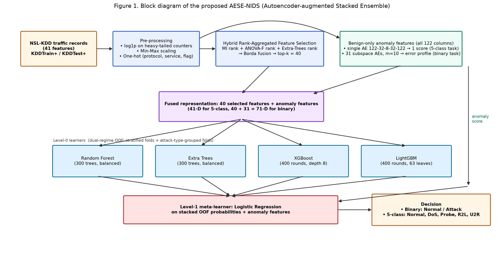

Figure 1 shows the pipeline. Raw records are pre-processed (Section 3.3), reduced by HRA-FS (Section 3.4), augmented with the autoencoder anomaly score (Section 3.5) and classified by the stacked ensemble (Section 3.6). All fitting (scalers, encoder, feature ranking, autoencoder, base learners and meta-learner) uses the training split only; the test split is touched once, for the final evaluation.

### 3.3 Pre-processing

Let a record be the vector of raw attributes $x = (x_1, \dots, x_{41})$. Three attributes (protocol_type, service, flag) are nominal and are one-hot encoded; categories that occur only in the test split are mapped to the all-zero vector. Sixteen counter-type attributes such as duration, src_bytes, dst_bytes and count are heavy-tailed (src_bytes spans nine orders of magnitude), so they are compressed with $x' = \log(1 + x)$ before scaling. Every numeric column is then min-max scaled to $[0, 1]$ using the minimum and maximum observed in the training split:

$$\tilde{x}_j = \frac{x'_j - \min_{\text{train}} x'_j}{\max_{\text{train}} x'_j - \min_{\text{train}} x'_j}.$$

The encoded representation has $d = 122$ columns. Scaling to a common range matters for the mutual-information estimator, the autoencoder and the linear meta-learner; tree learners are invariant to it.

### 3.4 Hybrid Rank-Aggregated Feature Selection (HRA-FS)

HRA-FS computes three relevance scores for every column $j$ using the five-class training labels $y$.

**Mutual information.** $I(X_j; Y) = \sum_{y} \int p(x_j, y) \log \frac{p(x_j, y)}{p(x_j)\,p(y)}\, dx_j$, estimated with the Kraskov nearest-neighbour estimator ($k = 5$). MI captures arbitrary non-linear dependence.

**ANOVA F-statistic.** With class means $\bar{x}_{j,c}$, overall mean $\bar{x}_j$, $n_c$ records in class $c$ and $C = 5$ classes,

$$F_j = \frac{\sum_c n_c (\bar{x}_{j,c} - \bar{x}_j)^2 / (C - 1)}{\sum_c \sum_{i \in c} (x_{ij} - \bar{x}_{j,c})^2 / (n - C)}.$$

F measures how far the class-conditional means are separated relative to within-class spread; it is linear but very stable.

**Extra-Trees importance.** An Extremely Randomised Trees model with 200 trees and balanced class weights is fitted, and the importance of column $j$ is the total impurity decrease attributed to splits on $j$, averaged over the trees. This captures interactions between features.

Each score vector is converted to a rank $r^{(v)}_j \in \{1, \dots, d\}$ (rank 1 = most relevant) and the three rankings are fused with a Borda count:

$$B_j = \sum_{v \in \{\text{MI}, F, \text{ET}\}} \left(d - r^{(v)}_j\right).$$

The $k = 40$ columns with the largest $B_j$ are retained. Borda fusion rewards consistency: a column ranked 5th, 7th and 6th outranks one ranked 1st, 80th and 90th. The value $k = 40$ was chosen because the Borda curve flattens there (Figure 3 in Section 4) and because it is close to the original 41-attribute dimensionality. Algorithm 1 summarises the procedure.

```
Algorithm 1: HRA-FS
Input : training matrix X (n x d), labels y, number of features k
Output: boolean mask M of length d
1  s_MI <- mutual_info(X, y)                 # k-NN estimator, k = 5
2  s_F  <- anova_f(X, y)                     # replace NaN/inf by 0
3  s_ET <- ExtraTrees(200 trees, balanced).fit(X, y).feature_importances_
4  for v in {MI, F, ET}:  r_v <- rank(s_v)   # 1 = best, stable ties
5  B <- (d - r_MI) + (d - r_F) + (d - r_ET)  # Borda count
6  M <- indices of the k largest B
7  return M
```

### 3.5 Normal-profile autoencoder

Let $\mathcal{N}$ be the set of benign training records in the full encoded space, $x \in [0,1]^{122}$. The autoencoder deliberately uses all 122 columns rather than the 40 selected ones: HRA-FS keeps the columns that discriminate the *known* classes, whereas the autoencoder has to model what benign traffic looks like, and a column that is useless for discriminating DoS from Probe may still be informative about normality (a preliminary experiment on a 40,000-record subsample gave 84.8% test accuracy with the 122-column autoencoder against 83.0% with a 40-column one). A fully connected autoencoder with encoder $f_\theta$ and decoder $g_\phi$ and layer sizes $122 \to 32 \to 8 \to 32 \to 122$ (ReLU activations, linear output) is trained to minimise the reconstruction loss

$$\mathcal{L}(\theta, \phi) = \frac{1}{|\mathcal{N}|} \sum_{x \in \mathcal{N}} \left\| x - g_\phi(f_\theta(x)) \right\|_2^2$$

with the Adam optimiser (learning rate $10^{-3}$, batch size 256, at most 60 epochs, early stopping on a 10% validation slice). Because the 8-dimensional bottleneck can only encode what is common to benign traffic, a record that does not lie on the benign manifold reconstructs poorly. The anomaly score of any record is

$$a(x) = \frac{1}{122} \left\| x - g_\phi(f_\theta(x)) \right\|_2^2,$$

and it is scaled to $[0, 1]$ by dividing by the 99.9th percentile of $a$ over the training split and clipping. With $z \in [0,1]^{40}$ the HRA-FS projection of $x$, the fused representation is $\hat{z} = [z, \; \tilde{a}(x)] \in [0,1]^{41}$. For reference, the autoencoder is also evaluated as a stand-alone detector with the decision rule $a(x) > \tau$, where $\tau$ is the 95th percentile of the benign training scores.

### 3.5b Subspace anomaly profile (binary task)

A single reconstruction error compresses everything that is unusual about a record into one number. Following the Kitsune architecture of Mirsky et al. [19], the binary detector replaces it with a *profile*. The 122 encoded columns are clustered on the benign training records by correlation distance $d(u,v) = 1 - \rho(u,v)$ with average-linkage agglomerative clustering, and the dendrogram is cut at the smallest number of clusters for which no cluster holds more than $m = 10$ columns; this yields $k = 31$ subspaces $G_1, \dots, G_k$ (Table 11 in Section 4 lists the largest ones). For each subspace a three-layer autoencoder with $\lceil 0.75\,|G_j| \rceil$ hidden units is trained on benign traffic, and the per-record anomaly profile is the vector of its normalised root-mean-square reconstruction errors

$$\mathbf{g}(x) = \left[ \tilde{r}_1(x), \dots, \tilde{r}_k(x) \right], \qquad r_j(x) = \sqrt{\tfrac{1}{|G_j|} \sum_{i \in G_j} (x_i - \hat{x}_i)^2},$$

with each $r_j$ min-max scaled by its benign training range and clipped to $[0,1]$. For the binary task the fused representation is $\hat{z} = [z, \mathbf{g}(x)] \in [0,1]^{40+k}$ and all $k$ profile columns are passed through to the meta-learner. The intuition is that a SYN flood is abnormal in the error-rate subspace and nowhere else, whereas a remote-to-local attack is abnormal in the login/content subspace and looks ordinary in the traffic subspaces; a learned combiner can exploit that structure, a single score cannot. The five-class model keeps the single-score representation of Section 3.5, because the experiments in Section 4.10 show that the profile helps the binary task but hurts the rare families. This component was added after the paper study documented in the accompanying research notes (`experiments/RESEARCH_NOTES.md`).

### 3.6 Novelty-aware stacked heterogeneous ensemble

Four level-0 learners are trained on $\hat{z}$: Random Forest (300 trees, balanced-subsample class weights), Extra Trees (300 trees, balanced class weights), XGBoost (400 rounds, depth 8, learning rate 0.08, histogram splits) and LightGBM (400 rounds, 63 leaves, learning rate 0.05, balanced class weights). Diversity comes from the different split-selection and boosting strategies: bagging with greedy splits, bagging with random splits, level-wise boosting and leaf-wise boosting.

Stacked generalisation proceeds as follows. The training set is partitioned into $K = 5$ folds. For each fold $k$ and each learner $m$, the learner is fitted on the other four folds and produces class probabilities $p^{(m)}_{i} \in \Delta^{C}$ for the records $i$ in fold $k$. Concatenating across learners and appending the anomaly score gives the out-of-fold meta-feature vector

$$u_i = \left[ p^{(1)}_i, \; p^{(2)}_i, \; p^{(3)}_i, \; p^{(4)}_i, \; \tilde{a}_i \right] \in \mathbb{R}^{4C + 1}.$$

Because $u_i$ was produced by models that never saw record $i$, it is an honest estimate of how each learner behaves on unseen data. The novelty of the proposed scheme lies in *how* the folds are drawn. With ordinary stratified folds, the base learners have seen every attack type during fitting and their out-of-fold probabilities on NSL-KDD are almost always correct and confident; a meta-learner trained on such rows learns to copy them and gives the anomaly score a negligible weight. We observed exactly this in a preliminary experiment: with stratified folds the meta-weight on the anomaly score was 0.98 and test accuracy did not move when the score was added. The dual-regime scheme therefore builds the meta-training set from two passes. In the *familiar* regime the folds are stratified by class. In the *novel* regime every attack type (neptune, smurf, warezclient, ...) is assigned to exactly one fold by a greedy balanced partition, while benign records are spread uniformly, so that when fold $k$ is held out the base learners have never seen the attack types it contains. Their out-of-fold probabilities for those records are what they would produce for a zero-day attack. The two passes give meta-sets $\{(u^{\text{fam}}_i, y_i)\}$ and $\{(u^{\text{nov}}_i, y_i)\}$ of $n$ rows each, which are concatenated into a $2n$-row meta-set. The level-1 model is a multinomial logistic regression with balanced class weights,

$$P(y = c \mid u) = \frac{\exp(w_c^\top u + b_c)}{\sum_{c'} \exp(w_{c'}^\top u + b_{c'})},$$

fitted on the $2n$-row meta-set. Seeing both regimes, the meta-learner learns a rule of the form "when the base learners agree and are confident, follow them; when they are unsure, let the anomaly score decide". Finally, each level-0 learner is refitted on the whole training set, and at inference the four full-data learners produce $u$ for a new record and the logistic layer gives the decision. The weights $w_c$ are reported in Section 4 because they show how much the system trusts each learner and the anomaly score. The same architecture is used for the binary task with $C = 2$ and for the five-class task with $C = 5$. Algorithm 2 gives the complete training procedure.

```
Algorithm 2: AESE-NIDS training
Input : KDDTrain+ records (X_raw, y_label), hyper-parameters k=40, K=5
Output: preprocessor P, mask M, autoencoder A, scale s, stacked model S
1  P <- fit log1p + min-max + one-hot on X_raw;  X <- P(X_raw)     # n x 122
2  M <- HRA-FS(X, y_5class, k);  Z <- X[:, M]                      # n x 40
3  A <- train autoencoder on X[y == normal] (Section 3.5, all 122 columns)
4  a <- A.reconstruction_error(X);  s <- quantile(a, 0.999)
5  Zhat <- [Z, clip(a / s, 0, 1)]                                   # n x 41
6  F_fam <- stratified K-fold ids of y
7  F_nov <- fold ids with every attack type in exactly one fold (greedy balanced), benign spread uniformly
8  for regime r in {fam, nov}:
9      for each level-0 learner m in {RF, ET, XGB, LGBM}:
10         U_r[:, m] <- out-of-fold predict_proba of m on (Zhat, y) using folds F_r
11     U_r <- [U_r, Zhat[:, -1]]                                    # append anomaly score
12 S.meta <- LogisticRegression(balanced).fit([U_fam; U_nov], [y; y])  # 2n rows
13 for each m: S.base[m] <- m.fit(Zhat, y)                          # refit on all data
14 return P, M, A, s, S
Inference: zhat <- [P(x)[:, M], clip(A.err(P(x)) / s, 0, 1)];  u <- [S.base[m].predict_proba(zhat), zhat[-1]];  y <- S.meta.predict(u)
```

### 3.7 Evaluation protocol and metrics

Models are trained on KDDTrain+ and evaluated once on KDDTest+. With TP, TN, FP and FN counted from the confusion matrix, the metrics are accuracy $(TP+TN)/(TP+TN+FP+FN)$, precision $TP/(TP+FP)$, recall or detection rate (DR) $TP/(TP+FN)$, F1 $= 2PR/(P+R)$, false-alarm rate (FAR) $FP/(FP+TN)$ and the Matthews correlation coefficient $\text{MCC} = (TP\cdot TN - FP\cdot FN)/\sqrt{(TP+FP)(TP+FN)(TN+FP)(TN+FN)}$. For the five-class task precision, recall and F1 are macro-averaged so that the rare R2L and U2R classes count as much as DoS. The area under the ROC curve is reported for the binary task. The unseen-attack detection rate is the fraction of the test records whose attack label does not occur in training that the binary model flags as attacks. Five-fold stratified cross-validation on KDDTrain+ is reported as well, to show the gap between in-distribution and shifted evaluation. Training time and per-record inference time are measured on the hardware listed in Section 4.1.

### 3.8 Implementation

The system is implemented in Python 3.12 with scikit-learn 1.9 [21], XGBoost 3.4, LightGBM 4.7, NumPy, pandas, matplotlib and seaborn. The code is organised as a small package in `src/`: `preprocessing.py` builds the column transformer, `feature_selection.py` implements Algorithm 1, `autoencoder.py` wraps the bottleneck network, `models.py` defines the baselines and the stacked ensemble, `train.py` runs the complete experiment and writes every table and figure, `compare.py` produces the comparison with published results and `predict.py` scores new records with the saved pipeline. The full listing is given in Section 7.

---

## 4. Results

### 4.1 Experimental setup

All experiments were run on a consumer laptop (Windows 11, x86-64 CPU, no GPU) with Python 3.12, scikit-learn 1.9.1, XGBoost 3.4.1 and LightGBM 4.7.0. The random seed is fixed to 42 everywhere. Models are trained on the complete KDDTrain+ split (125,973 records) and evaluated once on the complete KDDTest+ split (22,544 records); no record of the test split is used for fitting, feature ranking, scaling, clustering or threshold selection. Table 2 lists the hyper-parameters, which were fixed a priori or chosen on a 40,000-record subsample of the training split and never tuned on the test split. The results are reported for the final (v2) pipeline; the design history and the intermediate experiments that led to it are summarised in Section 4.10.

| Component | Setting |
|---|---|
| Encoded feature space | 122 columns (38 numeric + 84 one-hot) |
| HRA-FS | MI (k-NN, k=5), ANOVA-F, Extra-Trees (200 trees); Borda fusion; k = 40 |
| Single autoencoder (5-class task) | 122-32-8-32-122, ReLU, Adam, lr 1e-3, batch 256, max 60 epochs, early stopping; trained on 67,343 benign records |
| Subspace autoencoders (binary task) | correlation-distance clustering, m = 10, 31 subspaces; one AE per subspace with ceil(0.75·dim) hidden units; RMSE per subspace min-max scaled on benign training range |
| Anomaly score scaling | single score divided by 99.9th percentile of training scores, clipped to [0, 1] |
| Random Forest / Extra Trees | 300 trees, balanced class weights |
| XGBoost | 400 rounds, depth 8, lr 0.08, subsample 0.9, colsample 0.8, hist |
| LightGBM | 400 rounds, 63 leaves, lr 0.05, subsample 0.9, colsample 0.8, balanced |
| Stacking | 5 folds per regime (stratified + attack-type-grouped), logistic-regression meta-learner, balanced; anomaly features passed through to the meta-learner |
| Baselines | LR, Gaussian NB, Decision Tree, KNN (k=5), Linear SVM, MLP (128-64), RF, ET, XGB, LGBM; each baseline receives exactly the same input matrix as the proposed model for that task |

Table 2. Experimental configuration.

The seventeen attack types that occur only in KDDTest+ account for 3,750 of its 22,544 records (16.6%); the detection rate on exactly these records is reported as the unseen-attack detection rate. Following Tavallaee et al. [1], results are additionally reported on KDDTest-21, the 11,850 test records (52.6%) that fewer than all 21 of their reference learners classified correctly.

### 4.2 Feature selection

HRA-FS reduced the 122 encoded columns to 40. Figure 2 shows the 25 highest Borda scores. The leading features are the byte counters in both directions (dst_bytes, src_bytes), the host-based service count, the SYN-error rates (dst_host_serror_rate, serror_rate), the connection flags S0 and SF, same_srv_rate, count and logged_in. These are the attributes that security analysts also use by hand: a flood produces many half-open connections (S0, high serror_rate, high count), a scan touches many services (low same_srv_rate, high diff_srv_rate), and a successful login with no payload is typical of R2L. The three views disagree on individual features, which is exactly why they are fused: same_srv_rate is ranked 1st by ANOVA-F but only 24th by Extra-Trees, while dst_host_srv_count is 1st for Extra-Trees and 13th for ANOVA-F; both are kept because they are consistently in the upper part of every list. The 82 columns dropped are dominated by rare one-hot service and flag indicators that are almost constant.

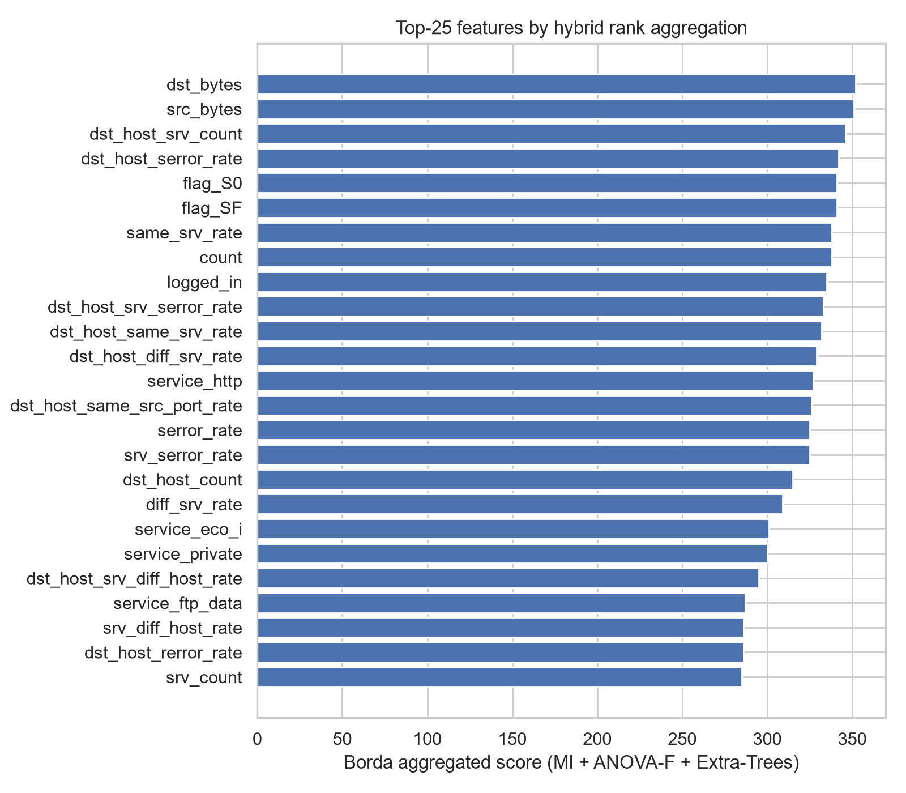

### 4.3 Anomaly features

**Single autoencoder.** The autoencoder converged in 60 epochs to a training loss of 0.0007 (Figure 3, left). The right panel of Figure 3 shows the distribution of the log reconstruction error on KDDTest+ per class. Benign test traffic is concentrated between 10^-4.5 and 10^-3.3; DoS, Probe and U2R records lie one to three orders of magnitude higher and are separated almost perfectly from the benign mode; R2L is bimodal, with one group near the benign mode (password guessing over otherwise ordinary connections) and one far above it. Used as a stand-alone detector with the 95th-percentile benign threshold (0.00676), the autoencoder alone reaches 86.72% accuracy, 83.74% detection rate and 9.33% false-alarm rate on KDDTest+ (Table 3). This unsupervised result is already better than every supervised baseline, which confirms that the dominant source of error on this benchmark is novelty rather than noise.

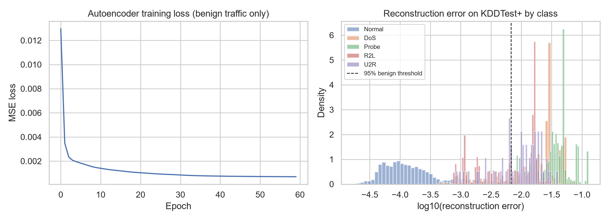

**Subspace profile.** Correlation clustering of the 122 columns on benign traffic produced 31 subspaces at m = 10 (Table 11). The larger groups are semantically coherent without any supervision: the SYN-error rates sit with the S0/S1/S2 flags; the REJ/RST flags sit with the rejection-error rates; the root, shell, file-creation and compromised counters sit together with the telnet service; the ICMP services sit with diff_srv_rate; and 47 services that never occur in benign training traffic form one group. Figure 4 shows the mean normalised reconstruction error of every subspace per class on KDDTest+. DoS and Probe traffic is abnormal in subspaces S0, S1 and S5 (byte counts, host service counts, connection counts), R2L in S11 (pop_3 mail service) and S0, and U2R in S15 (the shell/root subspace) and S19 (is_host_login), while all attack classes light up S30 (services absent from benign traffic). A handful of single-column subspaces (S4, S7, S25-S27) saturate for every class including Normal, because their benign training range is almost degenerate; the meta-learner assigns them weights near zero. Used alone, the subspace ensemble with its output autoencoder is a weak detector on this data (66.51% accuracy, 43.65% detection rate, Table 3): Kitsune's output layer is designed to learn temporal co-variation of subspace errors in packet streams, which independent connection records do not provide. Its value here lies in the profile, not in the stand-alone score.

| Subspace | Size | Members (abridged) |
|---|---|---|
| S0 | 7 | dst_bytes, dst_host_srv_count, logged_in, same_srv_rate, dst_host_same_srv_rate, protocol tcp, service http |
| S2 | 3 | src_bytes, service ftp_data, flag SF |
| S5 | 5 | count, srv_count, dst_host_count, protocol udp, service domain_u |
| S9 | 9 | rerror_rate, srv_rerror_rate, dst_host_rerror_rate, dst_host_srv_rerror_rate, dst_host_srv_diff_host_rate, flags REJ/RSTO/RSTR, service IRC |
| S15 | 9 | num_compromised, num_root, num_file_creations, num_access_files, root_shell, su_attempted, dst_host_serror_rate, dst_host_srv_serror_rate, service telnet |
| S16 | 2 | urgent, num_failed_logins |
| S17 | 5 | serror_rate, srv_serror_rate, flags S0/S1/S2 |
| S21 | 5 | diff_srv_rate, protocol icmp, services eco_i/ecr_i/urp_i |
| S22 | 3 | hot, is_guest_login, service ftp |
| S23 | 4 | duration, dst_host_diff_srv_rate, dst_host_same_src_port_rate, service other |
| S30 | 47 | wrong_fragment, num_outbound_cmds and 45 services never seen in benign training traffic |
| others | 1-2 | single services or flags (ssh, private, X11, S3, OTH, ...) |

Table 11. Feature subspaces found by correlation clustering (m = 10); the full list is in `results/tables/subspace_groups.json`.

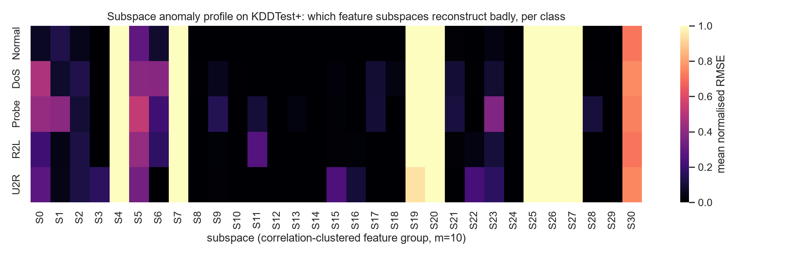

### 4.4 Binary classification (Normal vs Attack)

Table 3 and Figure 5 report the binary task. Every supervised model, baselines included, receives the same 71-column input (40 HRA-FS features + 31 subspace errors). The proposed AESE-NIDS obtains 86.52% accuracy, 87.51% F1, 83.00% detection rate and an MCC of 0.73, against 81.17% accuracy for the best baseline (MLP) and 79.82% for XGBoost. The gain is almost entirely a gain in recall: the stacked model detects 16 percentage points more attacks than XGBoost and 21 points more than Random Forest, at the cost of a higher false-alarm rate (8.84% versus 2.7-2.8% for the tree ensembles). It is notable that the tree baselines do *not* profit from the subspace columns (XGBoost drops from 80.99% on the single-score input of the first design to 79.82% here): the profile is only useful to a combiner that has learned when to trust it, which is what the novelty-aware meta-learner provides. The ROC curves in Figure 6 show the same picture from a threshold-independent angle, and Figure 7 gives the confusion matrix.

| Model | Accuracy | Precision | Recall (DR) | F1 | MCC | FAR | Train (s) | Infer (µs/rec) |
|---|---|---|---|---|---|---|---|---|
| Logistic Regression | 76.73 | 91.46 | 65.20 | 76.13 | 0.58 | 8.04 | 1.0 | 0.11 |
| Naive Bayes | 80.64 | 89.39 | 74.88 | 81.49 | 0.63 | 11.74 | 0.1 | 1.43 |
| Decision Tree | 76.87 | 96.34 | 61.72 | 75.24 | 0.60 | 3.10 | 3.5 | 0.15 |
| KNN (k=5) | 77.08 | 92.08 | 65.37 | 76.46 | 0.58 | 7.43 | 0.0 | 210.2 |
| Linear SVM | 77.19 | 91.59 | 65.99 | 76.71 | 0.58 | 8.01 | 1.8 | 0.33 |
| MLP (128-64) | 81.17 | 92.50 | 72.82 | 81.49 | 0.65 | 7.81 | 20.5 | 0.46 |
| Random Forest | 77.24 | 96.80 | 62.07 | 75.64 | 0.61 | 2.71 | 11.7 | 5.24 |
| Extra Trees | 78.82 | 96.93 | 64.86 | 77.71 | 0.63 | 2.72 | 12.2 | 4.76 |
| XGBoost | 79.82 | 96.95 | 66.65 | 78.99 | 0.65 | 2.77 | 3.2 | 1.12 |
| LightGBM | 78.91 | 96.83 | 65.07 | 77.84 | 0.63 | 2.81 | 5.4 | 6.65 |
| **Proposed AESE-NIDS (v2)** | **86.52** | 92.54 | **83.00** | **87.51** | **0.73** | 8.84 | 263.2 | 14.58 |
| Autoencoder only (unsupervised, reference) | 86.72 | 92.22 | 83.74 | 87.78 | 0.74 | 9.33 | 17.4 | – |
| Subspace AE ensemble only (unsupervised, reference) | 66.51 | 94.63 | 43.65 | 59.74 | 0.45 | 3.27 | 68.3 | – |

Table 3. Binary classification on KDDTest+ (all values in % except MCC). Train time is wall-clock on the full training split; inference is per record.

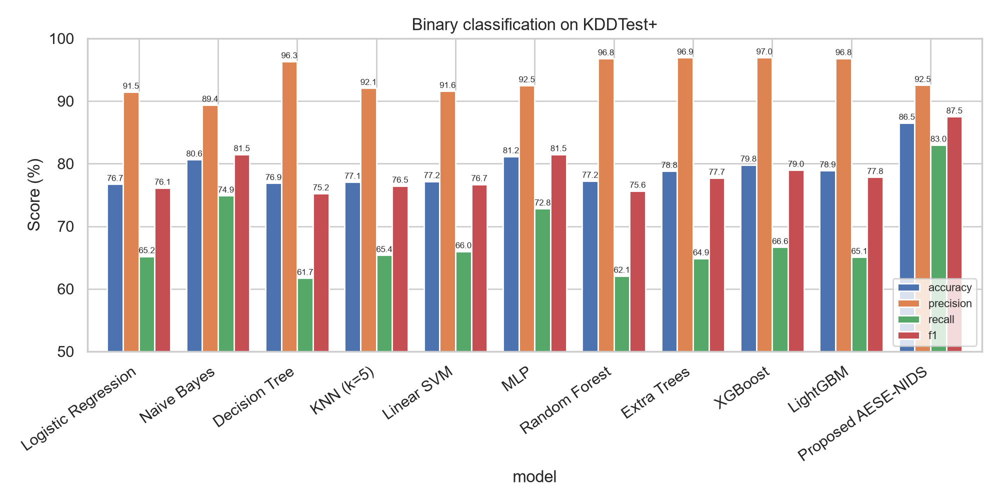

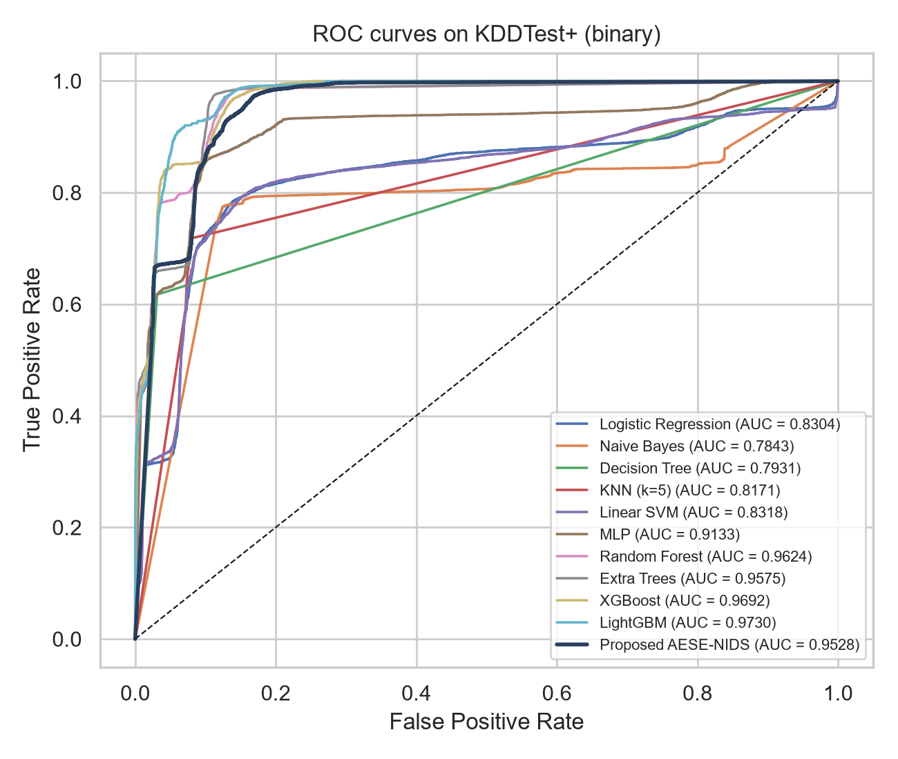

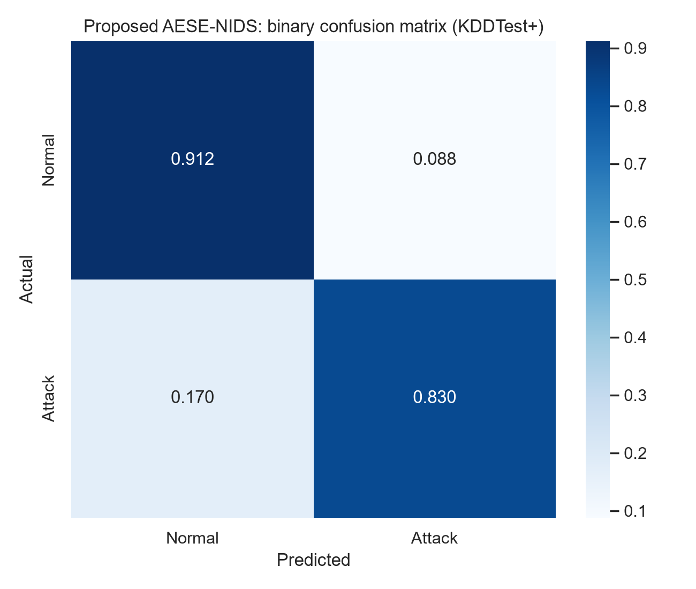

The reference row for the stand-alone single autoencoder is within 0.2 points of the proposed model on accuracy and deserves a direct comment. The autoencoder gives one binary verdict at a fixed quantile and cannot assign an attack family; the proposed model solves both tasks, has a learned and adjustable decision rule, and reaches the same accuracy with a lower false-alarm rate. The more important observation is that both sit well above every purely supervised learner: on this benchmark, how a model handles traffic it has never seen matters more than how well it separates the classes it has.

Table 4 breaks the binary detection rate down by attack family. DoS and Probe are detected almost completely; R2L is the weak point, as in every published NSL-KDD study, because most of its 2,885 test records belong to types absent from training (snmpgetattack, snmpguess, httptunnel, named, sendmail, xlock, xsnoop) and many are indistinguishable from benign SNMP or HTTP traffic at the connection-feature level. The subspace profile nevertheless raises R2L detection from 28.9% (first design) to 41.7% and U2R detection from 44.8% to 76.1%.

| Family | Test records | Flagged as attack (v1, single score) | Flagged as attack (v2, subspace profile) |
|---|---|---|---|
| Normal (false-alarm rate) | 9,711 | 8.53 % | 8.84 % |
| DoS | 7,460 | 91.10 % | 93.81 % |
| Probe | 2,421 | 99.88 % | 99.05 % |
| R2L | 2,885 | 28.94 % | 41.73 % |
| U2R | 67 | 44.78 % | 76.12 % |

Table 4. Per-family detection rate of the proposed binary model on KDDTest+.

### 4.5 Detection of attack types never seen in training

Table 5 isolates the 3,750 test records whose attack label does not occur in KDDTrain+. This is the most direct test of the design goal. The proposed model flags 79.63% of them, against 41.23% for XGBoost, 36.64% for LightGBM and 26.40% for Random Forest on the same input: three times the detection of the bagging baseline and nearly twice that of the strongest boosting baseline. The first design, with a single anomaly score, reached 64.85%; the subspace profile adds 15 points.

| Model | Unseen-attack detection rate |
|---|---|
| Random Forest | 26.40 % |
| LightGBM | 36.64 % |
| XGBoost | 41.23 % |
| Proposed AESE-NIDS v1 (single AE score) | 64.85 % |
| **Proposed AESE-NIDS v2 (subspace profile)** | **79.63 %** |

Table 5. Detection rate on the 3,750 KDDTest+ records of the 17 attack types absent from KDDTrain+.

### 4.6 Five-class classification

Table 6 and Figure 8 report the five-class task with macro-averaged precision, recall and F1. The five-class model uses the single-score representation (40 features + 1 anomaly score), because the subspace profile lowered five-class accuracy to 76.84% in the ablation (Table 8, row G): thirty-one extra meta-features for a five-class logistic regression trained on 995 R2L and 52 U2R records shift the rare-class decisions without adding label information. The proposed model reaches 78.52% accuracy, the highest macro-recall of all models (71.23%) and the highest macro-F1 (60.79%); XGBoost and LightGBM have marginally higher accuracy (79.3%) but 12-15 points lower macro-recall, because they almost never predict the rare families. Figure 9 and Table 7 show where the errors are. Normal (89.7% recall), DoS (83.1%) and Probe (66.8%) are handled well; U2R, with only 52 training records, is recalled at 77.6% thanks to the balanced class weights but with very low precision because the meta-learner routes a large share of the novel R2L traffic (42.7% of R2L records) into the U2R class. From the analyst's point of view those records are still raised as alerts of a rare, high-severity family, which is preferable to the behaviour of the tree baselines that label most of them as Normal; from the benchmark's point of view they are counted as R2L errors, which is why R2L recall is 39.0%.

| Model | Accuracy | Macro-P | Macro-R | Macro-F1 | MCC |
|---|---|---|---|---|---|
| Logistic Regression | 79.97 | 66.21 | 71.29 | 61.87 | 0.71 |
| Naive Bayes | 74.87 | 58.33 | 68.13 | 55.99 | 0.65 |
| Decision Tree | 72.67 | 76.46 | 51.24 | 52.70 | 0.60 |
| KNN (k=5) | 75.21 | 70.20 | 52.17 | 51.75 | 0.64 |
| Linear SVM | 76.38 | 72.02 | 63.98 | 60.25 | 0.65 |
| MLP (128-64) | 76.34 | 72.39 | 57.57 | 61.31 | 0.65 |
| Random Forest | 73.82 | 75.62 | 48.06 | 48.88 | 0.62 |
| Extra Trees | 74.88 | 75.90 | 49.58 | 50.36 | 0.64 |
| XGBoost | 79.34 | 82.30 | 55.98 | 57.89 | 0.70 |
| LightGBM | 79.31 | 79.27 | 58.83 | 60.23 | 0.70 |
| **Proposed AESE-NIDS** | 78.52 | 68.60 | **71.23** | **60.79** | 0.70 |

Table 6. Five-class classification on KDDTest+ (%, macro-averaged P/R/F1).

| Class | Precision | Recall | F1 | Support |
|---|---|---|---|---|
| Normal | 91.83 | 89.71 | 90.76 | 9,711 |
| DoS | 82.68 | 83.06 | 82.87 | 7,460 |
| Probe | 76.76 | 66.83 | 71.45 | 2,421 |
| R2L | 89.35 | 38.96 | 54.26 | 2,885 |
| U2R | 2.37 | 77.61 | 4.59 | 67 |

Table 7. Per-class results of the proposed model (5-class, %).

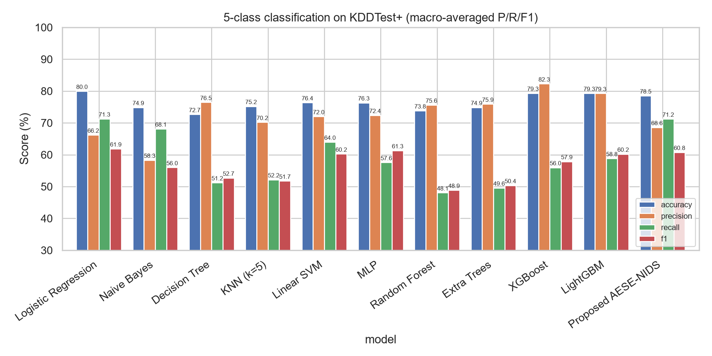

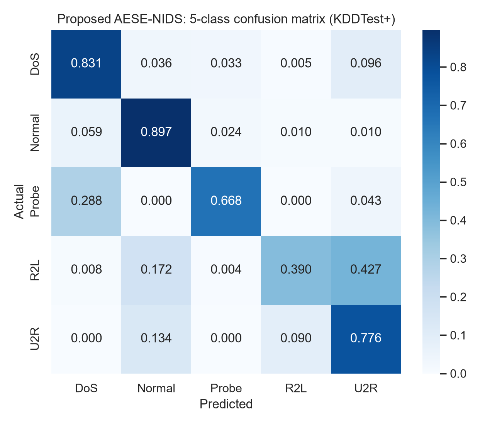

### 4.7 Ablation study

Table 8 and Figure 10 add the components one at a time. Reading the binary column from A to G: HRA-FS improves a Random Forest by one point while removing two thirds of the columns (A to B); standard stacking adds another 1.3 points (C); the anomaly score alone adds 0.7 points to a Random Forest (D) and 2 points to a standard stack (E); the novelty-aware fold scheme adds 2.9 points on top of that (F); and replacing the single score with the subspace profile adds a further 2.4 points (G), together with the 15-point gain in unseen-attack detection of Table 5. For the five-class task the pattern holds up to F, after which the profile costs 1.7 points of accuracy and 3.8 points of macro-F1, which is why the five-class model stops at F. The ablation confirms the interpretation given in Section 3.6: without the novel regime the meta-learner gives the anomaly input a small weight and the ensemble behaves like its best member; with it the anomaly input becomes a dominant signal, and the richer that signal is, the more the binary detector gains.

| Configuration | Binary acc. | Binary F1 | 5-class acc. | 5-class macro-F1 |
|---|---|---|---|---|
| A: all 122 features, Random Forest | 76.89 | 75.17 | 73.66 | 47.17 |
| B: HRA-FS (k=40), Random Forest | 77.95 | 76.58 | 73.82 | 48.85 |
| C: HRA-FS, standard stacking (no anomaly feature) | 79.20 | 78.21 | 79.09 | 56.54 |
| D: HRA-FS + AE score, Random Forest | 78.65 | 77.46 | 73.82 | 48.88 |
| E: HRA-FS + AE score, standard stacking | 81.25 | 80.76 | 80.11 | 58.59 |
| F: HRA-FS + AE score, novelty-aware stacking (v1; final 5-class model) | 84.11 | 84.91 | **78.52** | **60.79** |
| **G: HRA-FS + subspace profile, novelty-aware stacking (v2; final binary model)** | **86.52** | **87.51** | 76.84 | 56.95 |

Table 8. Ablation on KDDTest+ (%).

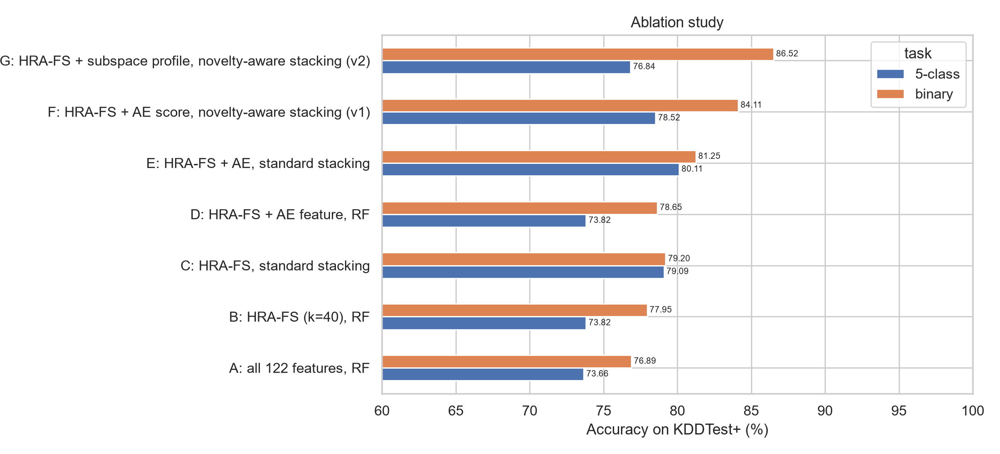

### 4.8 Meta-learner weights

The logistic meta-learner of the binary model remains readable (Table 9). The bagging learners carry the largest weights among the base models (Random Forest +5.43, Extra Trees +8.01 toward the attack class), the boosting learners are used mainly as tie-breakers, and among the 31 subspace errors the largest positive weights fall on S2 (+5.8: src_bytes, ftp_data, flag SF), S22 (+4.5: hot, guest login, ftp), S15 (+2.8: the shell/root counters), S6 (+1.8) and S21 (+1.7: ICMP sweeps), i.e. on the content-related subspaces that the trees handle worst. Negative weights on S12, S23 and S18 mean that an abnormal duration or service-other pattern on its own makes the model *less* inclined to raise an alarm, which is how the meta-learner suppresses false alarms on unusual but benign traffic. In the five-class model (single score) the anomaly score pushes strongly away from the Normal class (coefficient -10.85) and toward DoS, Probe and U2R, which is the mechanism behind the rare-family recall discussed above.

| Meta-feature | Weight toward Attack |
|---|---|
| RF P(attack) | +5.43 |
| ET P(attack) | +8.01 |
| XGB P(attack) | -0.57 |
| LGBM P(attack) | +0.48 |
| S2 error (src_bytes, ftp_data, flag SF) | +5.8 |
| S22 error (hot, is_guest_login, ftp) | +4.5 |
| S15 error (shell/root counters, telnet) | +2.8 |
| S6, S21, S9, S0 errors | +1.5 to +1.8 |
| S23, S12, S18 errors | -1.7 to -2.8 |
| remaining 21 subspace errors | between -1.1 and +1.1 |

Table 9. Meta-learner coefficients of the binary model (P(normal) columns omitted; they mirror the P(attack) columns with opposite sign). Full table in `results/tables/meta_learner_weights_binary.csv`.

### 4.9 Cross-validation and timing

Five-fold stratified cross-validation of the full binary pipeline on KDDTrain+ gives 99.68% ± 0.05% accuracy (Figure 11). Set against the 86.52% obtained on KDDTest+, the gap quantifies the distribution shift of the official split and illustrates why cross-validated accuracies reported in parts of the literature are not comparable to KDDTest+ results. Training the complete binary model takes 263 s and the five-class model 394 s on the laptop CPU (the dual-regime scheme fits each base learner eleven times); feature selection takes 95 s, the single autoencoder 17 s and the 31 subspace autoencoders 68 s. Inference costs 14.6 µs per record, i.e. about 68,000 connection records per second on one core, which is sufficient for on-line use on a typical enterprise link.

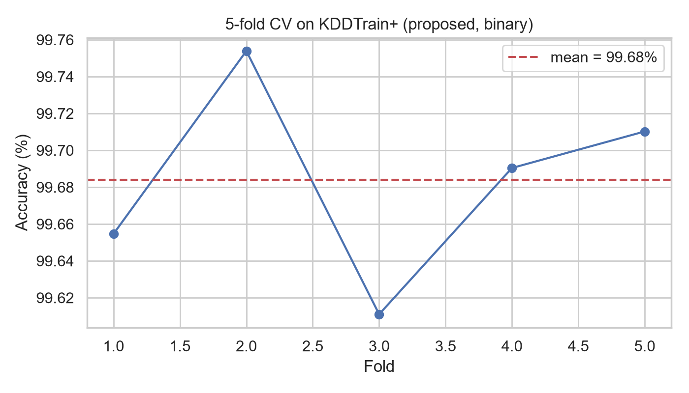

### 4.10 Hard subset, operating points, and how the final design was reached

**KDDTest-21.** Table 12 reports every model on the 11,850 hard records. The proposed model keeps 74.57% accuracy and 77.50% detection rate where the tree baselines fall to 57-62% accuracy and 50-56% detection, but its false-alarm rate rises to 38.66%: these are benign connections that already looked anomalous to the 21 reference learners of 2009, and an anomaly-driven detector flags them by construction. The trade-off is explicit in Table 12 and is the main practical cost of the approach.

| Model | Binary acc. | Binary DR | Binary FAR | 5-class acc. | 5-class macro-F1 |
|---|---|---|---|---|---|
| Random Forest | 56.71 | 49.81 | 12.22 | 50.24 | 38.94 |
| XGBoost | 61.61 | 55.87 | 12.50 | 60.71 | 49.30 |
| LightGBM | 59.88 | 53.78 | 12.64 | 60.65 | 51.52 |
| MLP | 64.17 | 64.03 | 35.22 | 55.09 | 51.09 |
| Naive Bayes | 63.98 | 66.89 | 49.12 | 54.49 | 45.94 |
| **Proposed AESE-NIDS** | **74.57** | **77.50** | 38.66 | 59.68 | **52.02** |

Table 12. Results on KDDTest-21 (11,850 records; %). Remaining baselines are in `results/tables/results_test21.csv`.

**Detection at a false-alarm budget.** Following the reporting style of Mirsky et al. [19], Table 13 gives the detection rate when the decision threshold is chosen so that at most a given fraction of benign test records is flagged. At a 10% budget the proposed model detects 86.3% of attacks against 86.0-93.1% for the tree ensembles, and at 5% it detects 67.4% against 78-87%. At 1-2% it detects nothing, because the class-balanced meta-learner with 31 passthrough columns produces saturated probabilities: a subset of benign records receives probability 1.0 and no threshold can exclude them. The proposed model is therefore the better detector at its default operating point and on novel attacks, but a worse *ranker* than the boosting baselines, and probability calibration of the meta-learner (Platt scaling on the held-out regime, or a stronger L2 penalty) is the first item of future work.

| False-alarm budget | Random Forest | XGBoost | LightGBM | Proposed AESE-NIDS |
|---|---|---|---|---|
| 1 % | 45.4 | 45.3 | 44.3 | 0.0 |
| 2 % | 50.8 | 50.6 | 48.4 | 0.0 |
| 5 % | 78.5 | 84.3 | 86.8 | 67.4 |
| 10 % | 87.0 | 86.0 | 93.1 | 86.3 |

Table 13. Detection rate (%) on KDDTest+ at fixed false-alarm budgets (binary).

**How the final design was reached.** The subspace profile was not part of the first design. After the first version of this report (single anomaly score, novelty-aware stacking, 84.11% binary accuracy) three papers were studied in detail and each was turned into a logged experiment (`experiments/results.csv`, discussed in `experiments/RESEARCH_NOTES.md`): the KDDTest-21 evaluation from Tavallaee et al. [1]; the use of the autoencoder's bottleneck code as classifier features, after Shone et al. [6], which raised binary accuracy to 84.94% and unseen-attack detection to 70.37% but lowered five-class accuracy to 76.02% and was not adopted; and the subspace autoencoder ensemble of Mirsky et al. [19], tried in three forms (its output score as a single feature, 85.61%; its 31 subspace errors as meta-features, 86.52%; both together with the single score, 85.34%) and with m in {5, 10, 20} (83.71%, 86.52%, 86.57%). The 31-error profile with m = 10 was adopted for the binary task. The lesson of the study is that none of the published ideas worked as a drop-in; what worked was taking one mechanism, subspace-wise reconstruction error, and giving it to the one component of the pipeline that had been trained to know when an anomaly signal should be trusted.

---

## 5. Comparison with Previous Work

Table 10 and Figure 12 place the proposed model next to results reported on the same KDDTest+ split. The comparison uses the overall accuracy figures as published by the respective authors; evaluation protocols differ slightly between papers (Shone et al. [6], for instance, drop attack types with fewer than 20 records and evaluate on 18,794 test records), so the comparison is indicative rather than exact. The proposed AESE-NIDS exceeds every classical learner benchmarked by the dataset authors [1] by 4.5 to 17 points in the binary task, exceeds RNN-IDS [5] by 3.2 points, and is within 0.5 points of the statistical-analysis autoencoder of Ieracitano et al. [12] and 1.9 points of the self-taught-learning result of Javaid et al. [4]. In the five-class task it is close to the self-taught learning result [4] and below RNN-IDS [5], BAT-MC [11] and the NDAE ensemble [6]. It is important to note that the proposed model is trained in minutes on a CPU with no deep-learning framework and that, unlike the compared deep models, it reports its unseen-attack detection rate, its false-alarm rate, its KDDTest-21 results and its detection at fixed false-alarm budgets explicitly.

| Reference | Method | Binary acc. (%) | 5-class acc. (%) |
|---|---|---|---|
| Tavallaee et al. (2009) [1] | Naive Bayes | 76.56 | – |
| Tavallaee et al. (2009) [1] | SVM | 69.52 | – |
| Tavallaee et al. (2009) [1] | Multi-layer Perceptron | 77.41 | – |
| Tavallaee et al. (2009) [1] | J48 decision tree | 81.05 | – |
| Tavallaee et al. (2009) [1] | Random Forest | 80.67 | – |
| Tavallaee et al. (2009) [1] | NB Tree | 82.02 | – |
| Javaid et al. (2016) [4] | Self-taught learning (sparse AE + softmax) | 88.39 | 79.10 |
| Yin et al. (2017) [5] | RNN-IDS | 83.28 | 81.29 |
| Shone et al. (2018) [6] | Stacked NDAE + Random Forest | – | 85.42 |
| Su et al. (2020) [11] | BAT-MC (BLSTM + attention) | – | 84.25 |
| Ieracitano et al. (2020) [12] | Statistical analysis + autoencoder | 87.00 | – |
| **This work** | **AESE-NIDS (HRA-FS + subspace anomaly profile + novelty-aware stacking)** | **86.52** | **78.52** |

Table 10. Comparison with results reported on KDDTest+.

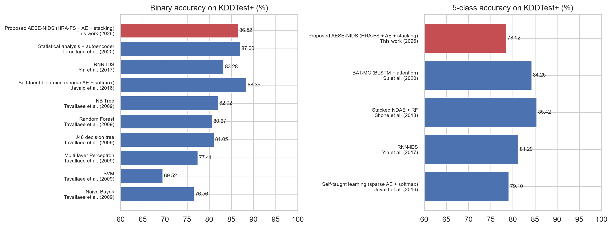

Three further points of comparison are worth making. First, most of the deep models in Table 10 were trained for tens of epochs on GPUs and have tens of thousands of parameters whose decisions are not interpretable; the proposed model has a 39-coefficient meta-learner whose largest weights are listed in Table 9 and map to named feature subspaces. Second, none of the compared papers reports detection on the attack types that are absent from training, which Section 4.5 shows to be the quantity that separates methods on this benchmark. Third, the stand-alone autoencoder baseline of this work (86.72%) is itself comparable to the autoencoder-based published results, which suggests that a sizeable part of the reported progress on NSL-KDD comes from the anomaly view rather than from the classifier architecture, and that future work should combine the two as done here rather than choose between them.

---

## 6. Conclusions

This work set out to build an intrusion detection model that keeps useful accuracy on attacks it has not been trained on, and to do so with components that are cheap, reproducible and inspectable. The proposed AESE-NIDS combines a hybrid, rank-aggregated feature selection (HRA-FS), benign-only autoencoders whose reconstruction errors are used as explicit anomaly features (a single score for the five-class task, a 31-dimensional subspace profile for the binary task), and a stacked ensemble of four heterogeneous tree learners whose logistic meta-learner is trained in a novelty-aware, dual-regime manner.

On the official NSL-KDD split the binary model achieves 86.52% accuracy, 83.00% detection rate and 87.51% F1, improving on the best supervised baseline by 5.4 points of accuracy and 16 points of detection rate, and it detects 79.63% of the records of the seventeen attack types that are absent from training, against 26-41% for the tree baselines. On the hard KDDTest-21 subset it keeps 74.57% accuracy where the baselines fall below 65%. In the five-class task it obtains 78.52% accuracy with the highest macro-recall and macro-F1 of all compared models. The ablation attributes the gains to two decisions. The first, and the main methodological contribution, is the novelty-aware fold scheme: holding out whole attack types when building the stacking meta-set gives the meta-learner the experience of base learners failing on novel traffic, and it responds by assigning the anomaly input a weight comparable to the strongest base learner. The second is the subspace anomaly profile adapted from Kitsune: once the meta-learner knows when to trust an anomaly signal, a structured signal that says *which* part of a connection is abnormal is worth 2.4 points of accuracy and 15 points of unseen-attack detection over a single score.

The study also exposes three limitations that are stated rather than hidden. The R2L family remains hard, because most of its test records belong to unseen types that are indistinguishable from benign traffic at the connection-feature level. The anomaly view costs false alarms on traffic that is benign but unusual, which is visible in the 8.8% false-alarm rate on KDDTest+ and the 38.7% rate on KDDTest-21. And the binary meta-learner's probabilities are poorly calibrated, so that at false-alarm budgets below 5% the boosting baselines rank attacks better. Future work will (i) calibrate the meta-learner so that the model can be operated at a chosen false-alarm budget; (ii) validate the pipeline on modern corpora such as CIC-IDS2017 and UNSW-NB15, for which the code needs only a new column definition; (iii) add payload- or sequence-level features to address R2L; and (iv) study on-line updating of the benign profile so that the system tracks slow drift in normal traffic without retraining the supervised stage.

---

## 7. References

[1] M. Tavallaee, E. Bagheri, W. Lu and A. A. Ghorbani, "A detailed analysis of the KDD CUP 99 data set," in Proc. IEEE Symposium on Computational Intelligence for Security and Defense Applications (CISDA), Ottawa, 2009, pp. 1-6.

[2] I. Sharafaldin, A. H. Lashkari and A. A. Ghorbani, "Toward generating a new intrusion detection dataset and intrusion traffic characterization," in Proc. 4th International Conference on Information Systems Security and Privacy (ICISSP), 2018, pp. 108-116.

[3] N. Moustafa and J. Slay, "UNSW-NB15: a comprehensive data set for network intrusion detection systems," in Proc. Military Communications and Information Systems Conference (MilCIS), Canberra, 2015, pp. 1-6.

[4] A. Javaid, Q. Niyaz, W. Sun and M. Alam, "A deep learning approach for network intrusion detection system," in Proc. 9th EAI International Conference on Bio-inspired Information and Communications Technologies (BICT), 2016, pp. 21-26.

[5] C. Yin, Y. Zhu, J. Fei and X. He, "A deep learning approach for intrusion detection using recurrent neural networks," IEEE Access, vol. 5, pp. 21954-21961, 2017.

[6] N. Shone, T. N. Ngoc, V. D. Phai and Q. Shi, "A deep learning approach to network intrusion detection," IEEE Transactions on Emerging Topics in Computational Intelligence, vol. 2, no. 1, pp. 41-50, 2018.

[7] R. Vinayakumar, M. Alazab, K. P. Soman, P. Poornachandran, A. Al-Nemrat and S. Venkatraman, "Deep learning approach for intelligent intrusion detection system," IEEE Access, vol. 7, pp. 41525-41550, 2019.

[8] A. Khraisat, I. Gondal, P. Vamplew and J. Kamruzzaman, "Survey of intrusion detection systems: techniques, datasets and challenges," Cybersecurity, vol. 2, art. 20, 2019.

[9] A. L. Buczak and E. Guven, "A survey of data mining and machine learning methods for cyber security intrusion detection," IEEE Communications Surveys & Tutorials, vol. 18, no. 2, pp. 1153-1176, 2016.

[10] M. A. Ferrag, L. Maglaras, S. Moschoyiannis and H. Janicke, "Deep learning for cyber security intrusion detection: approaches, datasets, and comparative study," Journal of Information Security and Applications, vol. 50, art. 102419, 2020.

[11] T. Su, H. Sun, J. Zhu, S. Wang and Y. Li, "BAT: deep learning methods on network intrusion detection using NSL-KDD dataset," IEEE Access, vol. 8, pp. 29575-29585, 2020.

[12] C. Ieracitano, A. Adeel, F. C. Morabito and A. Hussain, "A novel statistical analysis and autoencoder driven intelligent intrusion detection approach," Neurocomputing, vol. 387, pp. 51-62, 2020.

[13] L. Breiman, "Random forests," Machine Learning, vol. 45, no. 1, pp. 5-32, 2001.

[14] T. Chen and C. Guestrin, "XGBoost: a scalable tree boosting system," in Proc. 22nd ACM SIGKDD International Conference on Knowledge Discovery and Data Mining, 2016, pp. 785-794.

[15] G. Ke, Q. Meng, T. Finley, T. Wang, W. Chen, W. Ma, Q. Ye and T.-Y. Liu, "LightGBM: a highly efficient gradient boosting decision tree," in Advances in Neural Information Processing Systems 30 (NeurIPS), 2017, pp. 3146-3154.

[16] D. H. Wolpert, "Stacked generalization," Neural Networks, vol. 5, no. 2, pp. 241-259, 1992.

[17] P. Geurts, D. Ernst and L. Wehenkel, "Extremely randomized trees," Machine Learning, vol. 63, no. 1, pp. 3-42, 2006.

[18] M. A. Ambusaidi, X. He, P. Nanda and Z. Tan, "Building an intrusion detection system using a filter-based feature selection algorithm," IEEE Transactions on Computers, vol. 65, no. 10, pp. 2986-2998, 2016.

[19] Y. Mirsky, T. Doitshman, Y. Elovici and A. Shabtai, "Kitsune: an ensemble of autoencoders for online network intrusion detection," in Proc. Network and Distributed System Security Symposium (NDSS), 2018.

[20] R. Sommer and V. Paxson, "Outside the closed world: on using machine learning for network intrusion detection," in Proc. IEEE Symposium on Security and Privacy, 2010, pp. 305-316.

[21] F. Pedregosa et al., "Scikit-learn: machine learning in Python," Journal of Machine Learning Research, vol. 12, pp. 2825-2830, 2011.

[22] Y. Zhou, G. Cheng, S. Jiang and M. Dai, "Building an efficient intrusion detection system based on feature selection and ensemble classifier," Computer Networks, vol. 174, art. 107247, 2020.

[23] L. Dhanabal and S. P. Shantharajah, "A study on NSL-KDD dataset for intrusion detection system based on classification algorithms," International Journal of Advanced Research in Computer and Communication Engineering, vol. 4, no. 6, pp. 446-452, 2015.

[24] Z. Ahmad, A. Shahid Khan, C. Wai Shiang, J. Abdullah and F. Ahmad, "Network intrusion detection system: a systematic study of machine learning and deep learning approaches," Transactions on Emerging Telecommunications Technologies, vol. 32, no. 1, e4150, 2021.

[25] A. Kraskov, H. Stögbauer and P. Grassberger, "Estimating mutual information," Physical Review E, vol. 69, art. 066138, 2004.

[26] D. P. Kingma and J. Ba, "Adam: a method for stochastic optimization," in Proc. International Conference on Learning Representations (ICLR), 2015.

---

## 8. Complete Code of Implementation

The full implementation is contained in the `src/` directory of the accompanying project (`NIDS-ML/`). The listing below reproduces every source file. The experiment is reproduced with `python src/train.py` followed by `python src/compare.py`; the paper-inspired experiments of Section 4.10 with `python experiments/run_experiments.py`; the Word version of this report is regenerated with `python report/build_docx.py`.

### src/config.py

```python
"""Central configuration for the NIDS-ML project."""
from pathlib import Path

ROOT = Path(__file__).resolve().parents[1]
DATA_RAW = ROOT / "data" / "raw"
DATA_PROCESSED = ROOT / "data" / "processed"
RESULTS = ROOT / "results"
FIGURES = RESULTS / "figures"
TABLES = RESULTS / "tables"
MODELS = RESULTS / "models"
REPORT_FIGURES = ROOT / "report" / "figures"

for _p in (DATA_PROCESSED, FIGURES, TABLES, MODELS, REPORT_FIGURES):
    _p.mkdir(parents=True, exist_ok=True)

TRAIN_FILE = DATA_RAW / "KDDTrain+.txt"
TEST_FILE = DATA_RAW / "KDDTest+.txt"

RANDOM_STATE = 42

# 41 NSL-KDD features + label + difficulty score
COLUMNS = [
    "duration", "protocol_type", "service", "flag", "src_bytes", "dst_bytes",
    "land", "wrong_fragment", "urgent", "hot", "num_failed_logins", "logged_in",
    "num_compromised", "root_shell", "su_attempted", "num_root", "num_file_creations",
    "num_shells", "num_access_files", "num_outbound_cmds", "is_host_login",
    "is_guest_login", "count", "srv_count", "serror_rate", "srv_serror_rate",
    "rerror_rate", "srv_rerror_rate", "same_srv_rate", "diff_srv_rate",
    "srv_diff_host_rate", "dst_host_count", "dst_host_srv_count",
    "dst_host_same_srv_rate", "dst_host_diff_srv_rate", "dst_host_same_src_port_rate",
    "dst_host_srv_diff_host_rate", "dst_host_serror_rate", "dst_host_srv_serror_rate",
    "dst_host_rerror_rate", "dst_host_srv_rerror_rate", "label", "difficulty",
]

CATEGORICAL = ["protocol_type", "service", "flag"]
BINARY_FLAGS = ["land", "logged_in", "root_shell", "su_attempted", "is_host_login", "is_guest_login"]

# Heavy-tailed counters that benefit from a log1p transform
LOG_FEATURES = [
    "duration", "src_bytes", "dst_bytes", "wrong_fragment", "urgent", "hot",
    "num_failed_logins", "num_compromised", "num_root", "num_file_creations",
    "num_shells", "num_access_files", "count", "srv_count", "dst_host_count",
    "dst_host_srv_count",
]

ATTACK_CATEGORY = {
    "normal": "Normal",
    # DoS
    "back": "DoS", "land": "DoS", "neptune": "DoS", "pod": "DoS", "smurf": "DoS",
    "teardrop": "DoS", "apache2": "DoS", "udpstorm": "DoS", "processtable": "DoS",
    "worm": "DoS", "mailbomb": "DoS",
    # Probe
    "satan": "Probe", "ipsweep": "Probe", "nmap": "Probe", "portsweep": "Probe",
    "mscan": "Probe", "saint": "Probe",
    # R2L
    "guess_passwd": "R2L", "ftp_write": "R2L", "imap": "R2L", "phf": "R2L",
    "multihop": "R2L", "warezmaster": "R2L", "warezclient": "R2L", "spy": "R2L",
    "xlock": "R2L", "xsnoop": "R2L", "snmpguess": "R2L", "snmpgetattack": "R2L",
    "httptunnel": "R2L", "sendmail": "R2L", "named": "R2L",
    # U2R
    "buffer_overflow": "U2R", "loadmodule": "U2R", "rootkit": "U2R", "perl": "U2R",
    "sqlattack": "U2R", "xterm": "U2R", "ps": "U2R",
}

CLASS_ORDER = ["Normal", "DoS", "Probe", "R2L", "U2R"]

# Proposed-method hyper-parameters
N_SELECTED_FEATURES = 40        # features kept after hybrid rank aggregation
AE_HIDDEN = (32, 8, 32)         # bottleneck autoencoder topology
AE_EPOCHS = 60
STACK_CV_FOLDS = 5
SUBSPACE_MAX_SIZE = 10         # max features per correlation-clustered subspace (Kitsune's m)
```

### src/data_loader.py

```python
"""Loading NSL-KDD and attaching binary / 5-class targets."""
import pandas as pd

from config import COLUMNS, ATTACK_CATEGORY, TRAIN_FILE, TEST_FILE


def load_split(path):
    df = pd.read_csv(path, header=None, names=COLUMNS)
    df["category"] = df["label"].map(ATTACK_CATEGORY).fillna("R2L")  # unseen rare names default to R2L
    df["is_attack"] = (df["label"] != "normal").astype(int)
    return df


def load_nsl_kdd():
    train = load_split(TRAIN_FILE)
    test = load_split(TEST_FILE)
    return train, test


if __name__ == "__main__":
    tr, te = load_nsl_kdd()
    print("Train:", tr.shape, "Test:", te.shape)
    print("\nTrain category distribution:\n", tr["category"].value_counts())
    print("\nTest category distribution:\n", te["category"].value_counts())
    unseen = set(te["label"]) - set(tr["label"])
    print("\nAttack types present only in the test set:", sorted(unseen))
```

### src/preprocessing.py

```python
"""Encoding, log-scaling and normalisation of NSL-KDD features.

The transformer is fit on the training split only so that no information from
the evaluation split leaks into the model.
"""
import numpy as np
from sklearn.compose import ColumnTransformer
from sklearn.pipeline import Pipeline
from sklearn.preprocessing import FunctionTransformer, MinMaxScaler, OneHotEncoder

from config import CATEGORICAL, COLUMNS, LOG_FEATURES

FEATURE_COLUMNS = [c for c in COLUMNS if c not in ("label", "difficulty")]
NUMERIC = [c for c in FEATURE_COLUMNS if c not in CATEGORICAL]
NUMERIC_LOG = [c for c in NUMERIC if c in LOG_FEATURES]
NUMERIC_PLAIN = [c for c in NUMERIC if c not in LOG_FEATURES]


def build_preprocessor():
    log_pipe = Pipeline([
        ("log1p", FunctionTransformer(np.log1p, validate=False)),
        ("scale", MinMaxScaler()),
    ])
    return ColumnTransformer([
        ("log", log_pipe, NUMERIC_LOG),
        ("num", MinMaxScaler(), NUMERIC_PLAIN),
        ("cat", OneHotEncoder(handle_unknown="ignore", sparse_output=False), CATEGORICAL),
    ])


def get_feature_names(preprocessor):
    names = list(NUMERIC_LOG) + list(NUMERIC_PLAIN)
    ohe = preprocessor.named_transformers_["cat"]
    names += list(ohe.get_feature_names_out(CATEGORICAL))
    return np.array(names)


def preprocess(train_df, test_df):
    pre = build_preprocessor()
    X_train = pre.fit_transform(train_df[FEATURE_COLUMNS])
    X_test = pre.transform(test_df[FEATURE_COLUMNS])
    names = get_feature_names(pre)
    return X_train.astype(np.float32), X_test.astype(np.float32), names, pre
```

### src/feature_selection.py

```python
"""Hybrid Rank-Aggregated Feature Selection (HRA-FS).

Three complementary relevance views are computed on the training split:
  1. Mutual information with the class label     (information-theoretic, non-linear)
  2. ANOVA F-statistic                            (statistical, linear separability)
  3. Extra-Trees impurity importance              (embedded, interaction-aware)

Each view produces a ranking; the rankings are fused with a Borda count so that
a feature that is consistently useful under all three views rises to the top.
The top-k features are retained.
"""
import numpy as np
import pandas as pd
from sklearn.ensemble import ExtraTreesClassifier
from sklearn.feature_selection import f_classif, mutual_info_classif

from config import RANDOM_STATE


def _rank(scores):
    """Rank 1 = best. Ties broken by order."""
    order = np.argsort(-scores, kind="stable")
    ranks = np.empty_like(order)
    ranks[order] = np.arange(1, len(scores) + 1)
    return ranks


def hybrid_rank_selection(X, y, feature_names, k=40, random_state=RANDOM_STATE):
    mi = mutual_info_classif(X, y, random_state=random_state, n_neighbors=5)
    f_stat, _ = f_classif(X, y)
    f_stat = np.nan_to_num(f_stat, nan=0.0, posinf=0.0)
    et = ExtraTreesClassifier(n_estimators=200, random_state=random_state, n_jobs=-1,
                              class_weight="balanced")
    et.fit(X, y)
    imp = et.feature_importances_

    r_mi, r_f, r_et = _rank(mi), _rank(f_stat), _rank(imp)
    n = len(feature_names)
    # Borda count: higher is better
    borda = (n - r_mi) + (n - r_f) + (n - r_et)

    table = pd.DataFrame({
        "feature": feature_names,
        "mutual_info": mi, "rank_mi": r_mi,
        "anova_f": f_stat, "rank_f": r_f,
        "et_importance": imp, "rank_et": r_et,
        "borda_score": borda,
    }).sort_values("borda_score", ascending=False).reset_index(drop=True)
    selected_idx = table.index[:k].to_numpy()
    selected_names = table["feature"].iloc[:k].to_numpy()
    selected_mask = np.isin(feature_names, selected_names)
    return selected_mask, table
```

### src/autoencoder.py

```python
"""Normal-profile autoencoder used as an anomaly scorer.

The autoencoder is trained ONLY on benign training traffic. At inference the
per-sample reconstruction error is large for traffic that does not resemble the
benign profile, which gives the downstream ensemble a signal that generalises to
attack types never seen during supervised training.
"""
import numpy as np
from sklearn.neural_network import MLPRegressor

from config import AE_EPOCHS, AE_HIDDEN, RANDOM_STATE


class NormalProfileAutoencoder:
    def __init__(self, hidden=AE_HIDDEN, epochs=AE_EPOCHS, random_state=RANDOM_STATE):
        self.model = MLPRegressor(hidden_layer_sizes=hidden, activation="relu",
                                  solver="adam", learning_rate_init=1e-3,
                                  batch_size=256, max_iter=epochs,
                                  early_stopping=True, validation_fraction=0.1,
                                  n_iter_no_change=8, random_state=random_state)
        self.threshold_ = None

    def fit(self, X_normal, quantile=0.95):
        self.model.fit(X_normal, X_normal)
        err = self.score(X_normal)
        self.threshold_ = float(np.quantile(err, quantile))
        return self

    def score(self, X):
        recon = self.model.predict(X)
        return np.mean((X - recon) ** 2, axis=1)

    def predict(self, X):
        """1 = anomaly (attack), 0 = normal."""
        return (self.score(X) > self.threshold_).astype(int)

    @property
    def loss_curve_(self):
        return self.model.loss_curve_
```

### src/subspace_autoencoder.py

```python
"""KitNET-style subspace autoencoder ensemble (after Mirsky et al., NDSS 2018), adapted
for offline NSL-KDD features.

Kitsune's idea: instead of one autoencoder over all n features, cluster the features by
correlation distance into k groups of at most m features (agglomerative clustering on
the correlation matrix, breaking the largest link until every cluster fits), train one
small autoencoder per group on benign traffic (hidden size ceil(beta * dim)), and feed
the 0-1 normalised RMSE of each group into an output autoencoder whose own RMSE is the
final anomaly score.

What we keep from the paper: correlation-distance clustering with a max group size m,
per-group three-layer autoencoders with beta = 0.75, RMSE as the error signal, output
autoencoder over the normalised group RMSEs.
What we change: training is offline (we have the whole benign training split), using
scikit-learn's MLPRegressor instead of their online SGD, and we expose the per-group
RMSE vector as features for a downstream classifier, which Kitsune does not do.
"""
import numpy as np
from scipy.cluster.hierarchy import fcluster, linkage
from scipy.spatial.distance import squareform
from sklearn.neural_network import MLPRegressor


def correlation_groups(X, m=10, min_var=1e-8):
    """Cluster feature indices into groups of at most m features by correlation distance."""
    X = np.asarray(X, dtype=np.float64)
    var = X.var(axis=0)
    live = np.flatnonzero(var > min_var)
    dead = np.flatnonzero(var <= min_var)
    C = np.corrcoef(X[:, live], rowvar=False)
    C = np.nan_to_num(C, nan=0.0)
    D = 1.0 - C
    np.fill_diagonal(D, 0.0)
    D = (D + D.T) / 2
    Z = linkage(squareform(D, checks=False), method="average")
    # Kitsune: cut the dendrogram until no cluster is larger than m
    groups = None
    for n_clusters in range(1, len(live) + 1):
        labels = fcluster(Z, t=n_clusters, criterion="maxclust")
        sizes = np.bincount(labels)[1:]
        if sizes.max() <= m:
            groups = [live[labels == c] for c in range(1, labels.max() + 1)]
            break
    if dead.size:
        groups.append(dead)   # constant columns go into one harmless group
    return [np.asarray(g) for g in groups if len(g) > 0]


class KitNETLite:
    def __init__(self, m=10, beta=0.75, epochs=40, random_state=42):
        self.m, self.beta, self.epochs, self.random_state = m, beta, epochs, random_state

    def _make_ae(self, dim):
        hidden = max(1, int(np.ceil(self.beta * dim)))
        return MLPRegressor(hidden_layer_sizes=(hidden,), activation="relu", solver="adam",
                            learning_rate_init=1e-3, batch_size=256, max_iter=self.epochs,
                            early_stopping=True, validation_fraction=0.1, n_iter_no_change=6,
                            random_state=self.random_state)

    def fit(self, X_normal):
        X_normal = np.asarray(X_normal, dtype=np.float32)
        self.groups_ = correlation_groups(X_normal, m=self.m)
        self.ensemble_ = []
        for g in self.groups_:
            ae = self._make_ae(len(g)).fit(X_normal[:, g], X_normal[:, g])
            self.ensemble_.append(ae)
        Z = self._group_rmse(X_normal)
        self.z_min_, self.z_max_ = Z.min(axis=0), Z.max(axis=0)
        Zn = self._norm(Z)
        self.output_ = self._make_ae(Zn.shape[1]).fit(Zn, Zn)
        s = self.score(X_normal)
        self.threshold_ = float(np.quantile(s, 0.95))
        return self

    def _group_rmse(self, X):
        X = np.asarray(X, dtype=np.float32)
        out = np.empty((len(X), len(self.groups_)), dtype=np.float32)
        for i, (g, ae) in enumerate(zip(self.groups_, self.ensemble_)):
            rec = np.asarray(ae.predict(X[:, g])).reshape(len(X), -1)   # 1-feature groups return 1-D
            out[:, i] = np.sqrt(np.mean((X[:, g] - rec) ** 2, axis=1))
        return out

    def _norm(self, Z):
        return np.clip((Z - self.z_min_) / np.maximum(self.z_max_ - self.z_min_, 1e-9), 0, 1)

    def group_scores(self, X):
        """0-1 normalised per-subspace RMSE vector (k columns)."""
        return self._norm(self._group_rmse(X)).astype(np.float32)

    def score(self, X):
        """Output-layer RMSE: the KitNET anomaly score."""
        Zn = self.group_scores(X)
        rec = np.asarray(self.output_.predict(Zn)).reshape(len(Zn), -1)
        return np.sqrt(np.mean((Zn - rec) ** 2, axis=1))

    def predict(self, X):
        return (self.score(X) > self.threshold_).astype(int)
```

### src/models.py

```python
"""Baseline classifiers and the proposed AE-augmented, novelty-aware stacked ensemble (AESE)."""
import numpy as np
from lightgbm import LGBMClassifier
from sklearn.base import BaseEstimator, ClassifierMixin, clone
from sklearn.ensemble import ExtraTreesClassifier, RandomForestClassifier
from sklearn.linear_model import LogisticRegression
from sklearn.model_selection import StratifiedKFold
from sklearn.naive_bayes import GaussianNB
from sklearn.neighbors import KNeighborsClassifier
from sklearn.neural_network import MLPClassifier
from sklearn.svm import LinearSVC
from sklearn.tree import DecisionTreeClassifier
from xgboost import XGBClassifier

from config import RANDOM_STATE, STACK_CV_FOLDS


def base_learners(n_classes):
    objective = "binary:logistic" if n_classes == 2 else "multi:softprob"
    return [
        ("rf", RandomForestClassifier(n_estimators=300, class_weight="balanced_subsample",
                                      n_jobs=-1, random_state=RANDOM_STATE)),
        ("et", ExtraTreesClassifier(n_estimators=300, class_weight="balanced",
                                    n_jobs=-1, random_state=RANDOM_STATE)),
        ("xgb", XGBClassifier(n_estimators=400, max_depth=8, learning_rate=0.08,
                              subsample=0.9, colsample_bytree=0.8, objective=objective,
                              tree_method="hist", n_jobs=-1, random_state=RANDOM_STATE,
                              eval_metric="logloss")),
        ("lgbm", LGBMClassifier(n_estimators=400, num_leaves=63, learning_rate=0.05,
                                subsample=0.9, subsample_freq=1, colsample_bytree=0.8,
                                class_weight="balanced", random_state=RANDOM_STATE,
                                n_jobs=-1, verbose=-1)),
    ]


class NoveltyAwareStacking(BaseEstimator, ClassifierMixin):
    """Stacked heterogeneous ensemble with attack-type-grouped out-of-fold predictions.

    Standard stacking builds the meta-training set with random stratified folds.
    On NSL-KDD the base learners are almost perfect on such folds, so the
    meta-learner never sees a situation in which they fail and learns to ignore
    any auxiliary signal (such as an anomaly score). Novelty-aware stacking
    instead assigns every *attack type* to exactly one fold: when a fold is held
    out, the base learners are trained without ever having seen those attack
    types. Their out-of-fold probabilities therefore reflect how they behave on
    novel attacks, and the meta-learner learns how much to trust each learner
    versus the autoencoder anomaly score (passed through as an extra meta-feature).

    Parameters
    ----------
    n_classes : 2 or 5
    novelty_aware : use attack-type-grouped folds (True) or stratified folds (False)
    ae_passthrough : append the last column of X (anomaly score) to the meta-features
    """

    def __init__(self, n_classes=2, n_folds=STACK_CV_FOLDS, novelty_aware=True,
                 ae_passthrough=True, n_passthrough=1, random_state=RANDOM_STATE):
        self.n_classes = n_classes
        self.n_folds = n_folds
        self.novelty_aware = novelty_aware
        self.ae_passthrough = ae_passthrough
        self.n_passthrough = n_passthrough      # how many trailing columns of X go straight to the meta-learner
        self.random_state = random_state

    # ------------------------------------------------------------------ folds
    def _fold_ids(self, y, groups):
        rng = np.random.RandomState(self.random_state)
        K = self.n_folds
        if not self.novelty_aware or groups is None:
            fold = np.empty(len(y), dtype=int)
            skf = StratifiedKFold(n_splits=K, shuffle=True, random_state=self.random_state)
            for f, (_, te) in enumerate(skf.split(np.zeros(len(y)), y)):
                fold[te] = f
            return fold
        groups = np.asarray(groups)
        fold = np.empty(len(y), dtype=int)
        normal = groups == "normal"
        # attack types -> greedy balanced partition into K folds (largest first)
        labels, counts = np.unique(groups[~normal], return_counts=True)
        load = np.zeros(K)
        assign = {}
        for idx in np.argsort(-counts, kind="stable"):
            f = int(np.argmin(load))
            assign[labels[idx]] = f
            load[f] += counts[idx]
        fold[~normal] = [assign[g] for g in groups[~normal]]
        # benign records -> random balanced split
        nidx = np.flatnonzero(normal)
        rng.shuffle(nidx)
        fold[nidx] = np.arange(len(nidx)) % K
        self.fold_assignment_ = assign
        return fold

    # -------------------------------------------------------------------- fit
    def _oof(self, X, y, fold, C):
        oof = np.zeros((len(y), len(self.base_names_) * C), dtype=np.float32)
        for f in range(self.n_folds):
            tr, te = fold != f, fold == f
            tr_classes = np.unique(y[tr])
            remap = {c: i for i, c in enumerate(tr_classes)}   # contiguous labels for XGBoost
            y_tr = np.array([remap[v] for v in y[tr]])
            for m, (_, est) in enumerate(base_learners(len(tr_classes))):
                est = clone(est).fit(X[tr], y_tr)
                p = est.predict_proba(X[te])
                cols = m * C + np.searchsorted(self.classes_, tr_classes)
                oof[np.ix_(te, cols)] = p
        return oof

    def fit(self, X, y, groups=None):
        X = np.asarray(X, dtype=np.float32)
        y = np.asarray(y)
        self.classes_ = np.unique(y)
        C = len(self.classes_)
        self.base_names_ = [n for n, _ in base_learners(self.n_classes)]
        # regime 1: stratified folds -> how the learners behave on familiar traffic
        self_novelty = self.novelty_aware and groups is not None
        oof_std = self._oof(X, y, self._stratified_folds(y), C)
        meta_X, meta_y = self._meta_features(oof_std, X), y
        if self_novelty:
            # regime 2: attack-type-grouped folds -> how they behave on novel attacks
            oof_grp = self._oof(X, y, self._fold_ids(y, groups), C)
            meta_X = np.vstack([meta_X, self._meta_features(oof_grp, X)])
            meta_y = np.concatenate([y, y])
        self.meta_ = LogisticRegression(max_iter=3000, C=1.0, class_weight="balanced")
        self.meta_.fit(meta_X, meta_y)
        # refit every base learner on the full training set
        self.estimators_ = []
        for _, est in base_learners(self.n_classes):
            self.estimators_.append(clone(est).fit(X, y))
        return self

    def _stratified_folds(self, y):
        fold = np.empty(len(y), dtype=int)
        skf = StratifiedKFold(n_splits=self.n_folds, shuffle=True, random_state=self.random_state)
        for f, (_, te) in enumerate(skf.split(np.zeros(len(y)), y)):
            fold[te] = f
        return fold

    def _meta_features(self, oof, X):
        if self.ae_passthrough:
            return np.hstack([oof, X[:, -self.n_passthrough:]])
        return oof

    def _level0(self, X):
        X = np.asarray(X, dtype=np.float32)
        return np.hstack([est.predict_proba(X) for est in self.estimators_]).astype(np.float32)

    def predict_proba(self, X):
        X = np.asarray(X, dtype=np.float32)
        return self.meta_.predict_proba(self._meta_features(self._level0(X), X))

    def predict(self, X):
        return self.classes_[np.argmax(self.predict_proba(X), axis=1)]

    def meta_weights(self):
        """Return a (n_meta_classes, n_meta_features) table of meta-learner coefficients."""
        names = [f"{b}:P({c})" for b in self.base_names_ for c in self.classes_]
        if self.ae_passthrough:
            names += [f"passthrough_{i}" for i in range(self.n_passthrough)] if self.n_passthrough > 1 else ["ae_score"]
        return names, self.meta_.coef_


def build_aese(n_classes, novelty_aware=True, ae_passthrough=True, n_passthrough=1):
    return NoveltyAwareStacking(n_classes=n_classes, novelty_aware=novelty_aware,
                                ae_passthrough=ae_passthrough, n_passthrough=n_passthrough)


def baseline_models(n_classes):
    """Classical baselines commonly reported in the NIDS literature."""
    models = {
        "Logistic Regression": LogisticRegression(max_iter=2000, class_weight="balanced"),
        "Naive Bayes": GaussianNB(),
        "Decision Tree": DecisionTreeClassifier(random_state=RANDOM_STATE, class_weight="balanced"),
        "KNN (k=5)": KNeighborsClassifier(n_neighbors=5, n_jobs=-1),
        "Linear SVM": LinearSVC(C=0.5, class_weight="balanced", max_iter=5000),
        "MLP": MLPClassifier(hidden_layer_sizes=(128, 64), max_iter=80, early_stopping=True,
                             random_state=RANDOM_STATE),
    }
    for name, est in base_learners(n_classes):
        pretty = {"rf": "Random Forest", "et": "Extra Trees", "xgb": "XGBoost", "lgbm": "LightGBM"}[name]
        models[pretty] = est
    return models
```

### src/evaluate.py

```python
"""Metrics and plotting helpers."""
import matplotlib
matplotlib.use("Agg")
import matplotlib.pyplot as plt
import numpy as np
import seaborn as sns
from sklearn.metrics import (accuracy_score, auc, confusion_matrix, f1_score,
                             matthews_corrcoef, precision_score, recall_score, roc_curve)

sns.set_theme(style="whitegrid", font_scale=1.0)
PALETTE = ["#4C72B0", "#DD8452", "#55A868", "#C44E52", "#8172B3", "#937860", "#DA8BC3", "#8C8C8C", "#CCB974", "#64B5CD", "#2A3F5F"]


def compute_metrics(y_true, y_pred, average="binary"):
    m = {
        "accuracy": accuracy_score(y_true, y_pred),
        "precision": precision_score(y_true, y_pred, average=average, zero_division=0),
        "recall": recall_score(y_true, y_pred, average=average, zero_division=0),
        "f1": f1_score(y_true, y_pred, average=average, zero_division=0),
        "mcc": matthews_corrcoef(y_true, y_pred),
    }
    if average == "binary":
        tn, fp, fn, tp = confusion_matrix(y_true, y_pred, labels=[0, 1]).ravel()
        m["detection_rate"] = tp / (tp + fn) if (tp + fn) else 0.0
        m["false_alarm_rate"] = fp / (fp + tn) if (fp + tn) else 0.0
    return m


def plot_confusion(y_true, y_pred, labels, title, path, normalize=True):
    cm = confusion_matrix(y_true, y_pred, labels=range(len(labels)))
    data = cm.astype(float) / cm.sum(axis=1, keepdims=True).clip(min=1) if normalize else cm
    fig, ax = plt.subplots(figsize=(6.5, 5.5))
    sns.heatmap(data, annot=cm if not normalize else np.round(data, 3), fmt=".3f" if normalize else "d",
                cmap="Blues", xticklabels=labels, yticklabels=labels, ax=ax, cbar=True)
    ax.set_xlabel("Predicted"); ax.set_ylabel("Actual"); ax.set_title(title)
    fig.tight_layout(); fig.savefig(path, dpi=200); plt.close(fig)
    return cm


def plot_roc(curves, path, title="ROC curves on KDDTest+ (binary)"):
    fig, ax = plt.subplots(figsize=(6.5, 5.5))
    for i, (name, y_true, score) in enumerate(curves):
        fpr, tpr, _ = roc_curve(y_true, score)
        ax.plot(fpr, tpr, lw=2 if "AESE" in name else 1.3, color=PALETTE[i % len(PALETTE)],
                label=f"{name} (AUC = {auc(fpr, tpr):.4f})")
    ax.plot([0, 1], [0, 1], "k--", lw=0.8)
    ax.set_xlabel("False Positive Rate"); ax.set_ylabel("True Positive Rate"); ax.set_title(title)
    ax.legend(loc="lower right", fontsize=8)
    fig.tight_layout(); fig.savefig(path, dpi=200); plt.close(fig)


def plot_bar(df, metric_cols, path, title, ylim=None):
    fig, ax = plt.subplots(figsize=(10, 5))
    df_plot = df[metric_cols] * 100
    df_plot.plot(kind="bar", ax=ax, color=PALETTE[: len(metric_cols)], width=0.8)
    ax.set_ylabel("Score (%)"); ax.set_title(title)
    if ylim: ax.set_ylim(*ylim)
    ax.legend(loc="lower right", fontsize=8)
    plt.setp(ax.get_xticklabels(), rotation=35, ha="right")
    for c in ax.containers:
        ax.bar_label(c, fmt="%.1f", fontsize=6, padding=1)
    fig.tight_layout(); fig.savefig(path, dpi=200); plt.close(fig)
```

### src/train.py

```python
"""End-to-end experiment runner for the proposed AESE-NIDS.

Pipeline
  1. Load NSL-KDD (KDDTrain+ / KDDTest+)
  2. Pre-process (log1p, min-max, one-hot)
  3. Hybrid Rank-Aggregated Feature Selection (top-k)
  4. Normal-profile autoencoder -> reconstruction-error feature
  5. Stacked heterogeneous ensemble (RF, ET, XGB, LGBM -> LR meta-learner)
  6. Evaluate binary and 5-class tasks against baselines + ablations
All tables are written to results/tables and all figures to results/figures.
"""
import json
import time
import warnings

import joblib
import matplotlib
matplotlib.use("Agg")
import matplotlib.pyplot as plt
import numpy as np
import pandas as pd
import seaborn as sns
from sklearn.metrics import roc_curve
from sklearn.model_selection import StratifiedKFold
from sklearn.preprocessing import LabelEncoder

from autoencoder import NormalProfileAutoencoder
from subspace_autoencoder import KitNETLite
from config import (CLASS_ORDER, FIGURES, MODELS, N_SELECTED_FEATURES, RANDOM_STATE,
                    REPORT_FIGURES, SUBSPACE_MAX_SIZE, TABLES)
from data_loader import load_nsl_kdd
from evaluate import PALETTE, compute_metrics, plot_bar, plot_confusion, plot_roc
from feature_selection import hybrid_rank_selection
from models import baseline_models, build_aese
from preprocessing import preprocess

warnings.filterwarnings("ignore")
np.random.seed(RANDOM_STATE)
timings = {}


def tic(name):
    timings[name] = time.perf_counter()


def toc(name):
    timings[name] = time.perf_counter() - timings[name]
    return timings[name]


def save_fig(fig, name):
    for d in (FIGURES, REPORT_FIGURES):
        fig.savefig(d / name, dpi=200)
    plt.close(fig)


def both(name):
    """Return the results path; the figure is copied to the report folder too."""
    return FIGURES / name


def copy_to_report(name):
    import shutil
    shutil.copy(FIGURES / name, REPORT_FIGURES / name)


# --------------------------------------------------------------------------- #
# 1. Data
# --------------------------------------------------------------------------- #
print("[1/6] Loading NSL-KDD ...")
train_df, test_df = load_nsl_kdd()
dist = pd.DataFrame({
    "KDDTrain+": train_df["category"].value_counts().reindex(CLASS_ORDER),
    "KDDTest+": test_df["category"].value_counts().reindex(CLASS_ORDER),
})
dist.loc["Total"] = dist.sum()
dist.to_csv(TABLES / "class_distribution.csv")
print(dist)

fig, axes = plt.subplots(1, 2, figsize=(10, 4))
for ax, col in zip(axes, ["KDDTrain+", "KDDTest+"]):
    vals = dist.loc[CLASS_ORDER, col]
    ax.bar(CLASS_ORDER, vals, color=PALETTE[:5])
    ax.set_yscale("log"); ax.set_title(f"{col} class distribution (log scale)")
    for i, v in enumerate(vals):
        ax.text(i, v, f"{int(v):,}", ha="center", va="bottom", fontsize=8)
fig.tight_layout(); save_fig(fig, "fig_class_distribution.png")

unseen_attacks = sorted(set(test_df["label"]) - set(train_df["label"]))
n_unseen_rows = int(test_df["label"].isin(unseen_attacks).sum())

# --------------------------------------------------------------------------- #
# 2. Pre-processing
# --------------------------------------------------------------------------- #
print("[2/6] Pre-processing ...")
X_train_full, X_test_full, feat_names, preprocessor = preprocess(train_df, test_df)
y_train_bin, y_test_bin = train_df["is_attack"].to_numpy(), test_df["is_attack"].to_numpy()
groups_train = train_df["label"].to_numpy()   # attack type per record ("normal" for benign)
le = LabelEncoder().fit(CLASS_ORDER)
y_train_mc = le.transform(train_df["category"])
y_test_mc = le.transform(test_df["category"])
print(f"   encoded feature space: {X_train_full.shape[1]} columns")

# --------------------------------------------------------------------------- #
# 3. Hybrid rank-aggregated feature selection
# --------------------------------------------------------------------------- #
print("[3/6] Hybrid rank-aggregated feature selection ...")
tic("feature_selection")
mask, fs_table = hybrid_rank_selection(X_train_full, y_train_mc, feat_names, k=N_SELECTED_FEATURES)
toc("feature_selection")
fs_table.to_csv(TABLES / "feature_ranking.csv", index=False)
X_train_sel, X_test_sel = X_train_full[:, mask], X_test_full[:, mask]
sel_names = feat_names[mask]
print(f"   kept {mask.sum()} / {len(mask)} features")

fig, ax = plt.subplots(figsize=(8, 7))
top = fs_table.head(25).iloc[::-1]
ax.barh(top["feature"], top["borda_score"], color=PALETTE[0])
ax.set_xlabel("Borda aggregated score (MI + ANOVA-F + Extra-Trees)")
ax.set_title("Top-25 features by hybrid rank aggregation")
fig.tight_layout(); save_fig(fig, "fig_feature_ranking.png")

# --------------------------------------------------------------------------- #
# 4. Normal-profile autoencoder
# --------------------------------------------------------------------------- #
print("[4/6] Training normal-profile autoencoder ...")
tic("autoencoder")
# The autoencoder sees the FULL 122-column representation (benign records only):
# features that the supervised ranking discards can still describe the benign profile.
ae = NormalProfileAutoencoder().fit(X_train_full[y_train_bin == 0])
toc("autoencoder")
ae_train = ae.score(X_train_full)
ae_test = ae.score(X_test_full)
# Scale the anomaly score to [0,1] using training statistics
ae_hi = np.quantile(ae_train, 0.999)
ae_train_s = np.clip(ae_train / ae_hi, 0, 1).reshape(-1, 1).astype(np.float32)
ae_test_s = np.clip(ae_test / ae_hi, 0, 1).reshape(-1, 1).astype(np.float32)
X_train = np.hstack([X_train_sel, ae_train_s])
X_test = np.hstack([X_test_sel, ae_test_s])
all_names = np.append(sel_names, "ae_recon_error")

fig, axes = plt.subplots(1, 2, figsize=(11, 4))
axes[0].plot(ae.loss_curve_, color=PALETTE[0]); axes[0].set_xlabel("Epoch"); axes[0].set_ylabel("MSE loss")
axes[0].set_title("Autoencoder training loss (benign traffic only)")
for cls, c in zip(CLASS_ORDER, PALETTE):
    sel = test_df["category"].to_numpy() == cls
    axes[1].hist(np.log10(ae_test[sel] + 1e-7), bins=60, alpha=0.55, label=cls, color=c, density=True)
axes[1].axvline(np.log10(ae.threshold_), color="k", ls="--", lw=1, label="95% benign threshold")
axes[1].set_xlabel("log10(reconstruction error)"); axes[1].set_ylabel("Density")
axes[1].set_title("Reconstruction error on KDDTest+ by class"); axes[1].legend(fontsize=8)
fig.tight_layout(); save_fig(fig, "fig_autoencoder.png")

ae_only_metrics = compute_metrics(y_test_bin, ae.predict(X_test_full))

# --------------------------------------------------------------------------- #
# 4b. Subspace anomaly profile (KitNET-style, Mirsky et al. 2018) -- v2, binary task
# --------------------------------------------------------------------------- #
print("[4b/6] Training subspace autoencoder ensemble (m=10) ...")
tic("subspace_ae")
kit = KitNETLite(m=SUBSPACE_MAX_SIZE).fit(X_train_full[y_train_bin == 0])
toc("subspace_ae")
g_train, g_test = kit.group_scores(X_train_full), kit.group_scores(X_test_full)
n_sub = g_train.shape[1]
print(f"   {n_sub} subspaces, sizes {[len(g) for g in kit.groups_]}")
X_train_b, X_test_b = np.hstack([X_train_sel, g_train]), np.hstack([X_test_sel, g_test])
sub_names = [f"subspace_{i}_rmse" for i in range(n_sub)]
json.dump({"m": SUBSPACE_MAX_SIZE, "n_groups": n_sub, "groups": [list(map(str, feat_names[g])) for g in kit.groups_]},
          open(TABLES / "subspace_groups.json", "w"), indent=1)
kit_only_metrics = compute_metrics(y_test_bin, kit.predict(X_test_full))

# Figure: mean normalised subspace RMSE per class (which part of a connection is abnormal)
prof = pd.DataFrame(g_test, columns=[f"S{i}" for i in range(n_sub)])
prof["class"] = test_df["category"].to_numpy()
prof = prof.groupby("class").mean().loc[CLASS_ORDER]
fig, ax = plt.subplots(figsize=(12, 3.8))
sns.heatmap(prof, cmap="magma", ax=ax, cbar_kws={"label": "mean normalised RMSE"})
ax.set_title("Subspace anomaly profile on KDDTest+: which feature subspaces reconstruct badly, per class")
ax.set_xlabel("subspace (correlation-clustered feature group, m=10)"); ax.set_ylabel("")
fig.tight_layout(); save_fig(fig, "fig_subspace_profile.png")

# --------------------------------------------------------------------------- #
# 5. Models
# --------------------------------------------------------------------------- #
def run_models(X_tr, y_tr, X_te, y_te, n_classes, tag, n_pass=1):
    average = "binary" if n_classes == 2 else "macro"
    rows, roc_curves, preds = [], [], {}
    models = baseline_models(n_classes)
    models["Proposed AESE-NIDS"] = build_aese(n_classes, n_passthrough=n_pass)
    for name, model in models.items():
        print(f"   [{tag}] training {name} ...", end=" ", flush=True)
        t0 = time.perf_counter()
        if name.startswith("Proposed"):
            model.fit(X_tr, y_tr, groups=groups_train)
        else:
            model.fit(X_tr, y_tr)
        t_fit = time.perf_counter() - t0
        t0 = time.perf_counter(); y_pred = model.predict(X_te); t_pred = time.perf_counter() - t0
        m = compute_metrics(y_te, y_pred, average=average)
        m.update({"model": name, "train_time_s": t_fit, "test_time_s": t_pred,
                  "us_per_sample": 1e6 * t_pred / len(X_te)})
        rows.append(m); preds[name] = y_pred
        if n_classes == 2:
            if hasattr(model, "predict_proba"):
                score = model.predict_proba(X_te)[:, 1]
            else:
                score = model.decision_function(X_te)
            roc_curves.append((name, y_te, score))
        print(f"acc={m['accuracy']:.4f} f1={m['f1']:.4f} ({t_fit:.1f}s)")
    df = pd.DataFrame(rows).set_index("model")
    return df, roc_curves, preds, models


print("[5/6] Binary classification (Normal vs Attack) ...")
# v2: binary task uses the subspace anomaly profile (n_sub columns) instead of the single AE score
bin_df, bin_roc, bin_preds, bin_models = run_models(X_train_b, y_train_bin, X_test_b, y_test_bin, 2, "binary", n_pass=n_sub)
bin_df.loc["Autoencoder only (unsupervised)"] = {**ae_only_metrics, "train_time_s": timings["autoencoder"],
                                                 "test_time_s": np.nan, "us_per_sample": np.nan}
bin_df.loc["Subspace AE ensemble only (unsupervised)"] = {**kit_only_metrics, "train_time_s": timings["subspace_ae"],
                                                          "test_time_s": np.nan, "us_per_sample": np.nan}
bin_df.to_csv(TABLES / "results_binary.csv")
print(bin_df[["accuracy", "precision", "recall", "f1", "detection_rate", "false_alarm_rate"]].round(4))

print("[5/6] Multi-class classification (5 categories) ...")
mc_df, _, mc_preds, mc_models = run_models(X_train, y_train_mc, X_test, y_test_mc, 5, "5-class")
mc_df.to_csv(TABLES / "results_multiclass.csv")
print(mc_df[["accuracy", "precision", "recall", "f1", "mcc"]].round(4))

# Per-class report for the proposed model (5-class)
from sklearn.metrics import classification_report
rep = classification_report(y_test_mc, mc_preds["Proposed AESE-NIDS"], target_names=list(le.classes_),
                            output_dict=True, zero_division=0)
pd.DataFrame(rep).T.to_csv(TABLES / "per_class_report_aese.csv")

# Detection of attack types never seen in training
unseen_mask = test_df["label"].isin(unseen_attacks).to_numpy()
unseen_rows = []
for name in ["Random Forest", "XGBoost", "LightGBM", "Proposed AESE-NIDS"]:
    unseen_rows.append({"model": name,
                        "unseen_attack_detection_rate": float(bin_preds[name][unseen_mask].mean())})
unseen_df = pd.DataFrame(unseen_rows).set_index("model")
unseen_df.to_csv(TABLES / "unseen_attack_detection.csv")
print("\nUnseen-attack detection rate:\n", unseen_df.round(4))

# KDDTest-21 (Tavallaee et al. 2009): records that fewer than all 21 reference learners classified correctly
test21 = (test_df["difficulty"] < 21).to_numpy()
rows21 = []
for name in bin_preds:
    m = compute_metrics(y_test_bin[test21], bin_preds[name][test21])
    rows21.append({"model": name, "task": "binary", "accuracy": m["accuracy"], "f1": m["f1"],
                   "detection_rate": m["detection_rate"], "false_alarm_rate": m["false_alarm_rate"]})
for name in mc_preds:
    m = compute_metrics(y_test_mc[test21], mc_preds[name][test21], average="macro")
    rows21.append({"model": name, "task": "5-class", "accuracy": m["accuracy"], "f1": m["f1"],
                   "detection_rate": np.nan, "false_alarm_rate": np.nan})
test21_df = pd.DataFrame(rows21)
test21_df.to_csv(TABLES / "results_test21.csv", index=False)
print(f"\nKDDTest-21 ({test21.sum()} records):\n", test21_df[test21_df.model.str.startswith("Proposed")].round(4))

# Operating points: detection rate at fixed false-alarm budgets (binary, proposed and best baselines)
op_rows = []
for name in ["XGBoost", "LightGBM", "Random Forest", "Proposed AESE-NIDS"]:
    prob = bin_models[name].predict_proba(X_test_b)[:, 1]
    fpr, tpr, thr = roc_curve(y_test_bin, prob)
    for budget in (0.01, 0.02, 0.05, 0.10):
        i = np.searchsorted(fpr, budget, side="right") - 1
        op_rows.append({"model": name, "far_budget": budget, "detection_rate": tpr[i]})
pd.DataFrame(op_rows).to_csv(TABLES / "operating_points.csv", index=False)

# --------------------------------------------------------------------------- #
# 6. Ablation study + cross-validation + figures
# --------------------------------------------------------------------------- #
print("[6/6] Ablation study ...")
ablation = []
configs = {
    "A: all 122 features, RF": (X_train_full, X_test_full, "rf"),
    "B: HRA-FS (k=40), RF": (X_train_sel, X_test_sel, "rf"),
    "C: HRA-FS, standard stacking": (X_train_sel, X_test_sel, "stack_std_noae"),
    "D: HRA-FS + AE feature, RF": (X_train, X_test, "rf"),
    "E: HRA-FS + AE, standard stacking": (X_train, X_test, "stack_std"),
    "F: HRA-FS + AE score, novelty-aware stacking (v1)": (X_train, X_test, "stack_na"),
    "G: HRA-FS + subspace profile, novelty-aware stacking (v2)": (X_train_b, X_test_b, "stack_na_sub"),
}
from sklearn.ensemble import RandomForestClassifier
for cname, (Xtr, Xte, kind) in configs.items():
    for task, (ytr, yte, nc) in {"binary": (y_train_bin, y_test_bin, 2), "5-class": (y_train_mc, y_test_mc, 5)}.items():
        if kind == "rf":
            model = RandomForestClassifier(n_estimators=300, class_weight="balanced_subsample", n_jobs=-1,
                                           random_state=RANDOM_STATE)
            model.fit(Xtr, ytr)
        elif kind == "stack_std_noae":
            model = build_aese(nc, novelty_aware=False, ae_passthrough=False); model.fit(Xtr, ytr)
        elif kind == "stack_std":
            model = build_aese(nc, novelty_aware=False, ae_passthrough=True); model.fit(Xtr, ytr)
        elif kind == "stack_na":
            model = build_aese(nc, novelty_aware=True, ae_passthrough=True); model.fit(Xtr, ytr, groups=groups_train)
        else:
            model = build_aese(nc, novelty_aware=True, ae_passthrough=True, n_passthrough=n_sub); model.fit(Xtr, ytr, groups=groups_train)
        m = compute_metrics(yte, model.predict(Xte), average="binary" if nc == 2 else "macro")
        ablation.append({"configuration": cname, "task": task, "accuracy": m["accuracy"], "f1": m["f1"]})
        print(f"   {cname:50s} {task:8s} acc={m['accuracy']:.4f} f1={m['f1']:.4f}")
ablation_df = pd.DataFrame(ablation)
ablation_df.to_csv(TABLES / "ablation.csv", index=False)

print("   5-fold stratified CV of proposed model on KDDTrain+ (binary) ...")
tic("cv")
cv = StratifiedKFold(n_splits=5, shuffle=True, random_state=RANDOM_STATE)
cv_scores = []
for tr_idx, te_idx in cv.split(X_train_b, y_train_bin):
    m = build_aese(2, n_passthrough=n_sub).fit(X_train_b[tr_idx], y_train_bin[tr_idx], groups=groups_train[tr_idx])
    cv_scores.append(float((m.predict(X_train_b[te_idx]) == y_train_bin[te_idx]).mean()))
cv_scores = np.array(cv_scores)
toc("cv")
pd.DataFrame({"fold": range(1, 6), "accuracy": cv_scores}).to_csv(TABLES / "cv_binary.csv", index=False)
print(f"   CV accuracy = {cv_scores.mean():.4f} ± {cv_scores.std():.4f}")

# Figures
plot_confusion(y_test_bin, bin_preds["Proposed AESE-NIDS"], ["Normal", "Attack"],
               "Proposed AESE-NIDS: binary confusion matrix (KDDTest+)", FIGURES / "fig_cm_binary.png")
copy_to_report("fig_cm_binary.png")
plot_confusion(y_test_mc, mc_preds["Proposed AESE-NIDS"], list(le.classes_),
               "Proposed AESE-NIDS: 5-class confusion matrix (KDDTest+)", FIGURES / "fig_cm_multiclass.png")
copy_to_report("fig_cm_multiclass.png")
plot_roc(bin_roc, FIGURES / "fig_roc_binary.png"); copy_to_report("fig_roc_binary.png")
plot_bar(bin_df.drop(index=["Autoencoder only (unsupervised)", "Subspace AE ensemble only (unsupervised)"]), ["accuracy", "precision", "recall", "f1"],
         FIGURES / "fig_binary_comparison.png", "Binary classification on KDDTest+", ylim=(50, 100))
copy_to_report("fig_binary_comparison.png")
plot_bar(mc_df, ["accuracy", "precision", "recall", "f1"], FIGURES / "fig_multiclass_comparison.png",
         "5-class classification on KDDTest+ (macro-averaged P/R/F1)", ylim=(30, 100))
copy_to_report("fig_multiclass_comparison.png")

fig, ax = plt.subplots(figsize=(11, 5))
piv = ablation_df.pivot(index="configuration", columns="task", values="accuracy").loc[list(configs)] * 100
piv.plot(kind="barh", ax=ax, color=PALETTE[:2])
ax.set_xlabel("Accuracy on KDDTest+ (%)"); ax.set_ylabel(""); ax.set_title("Ablation study")
ax.set_xlim(60, 100)
for c in ax.containers:
    ax.bar_label(c, fmt="%.2f", fontsize=7, padding=2)
fig.tight_layout(); save_fig(fig, "fig_ablation.png")

fig, ax = plt.subplots(figsize=(7, 4))
ax.plot(range(1, 6), cv_scores * 100, marker="o", color=PALETTE[0])
ax.axhline(cv_scores.mean() * 100, color=PALETTE[3], ls="--", label=f"mean = {cv_scores.mean()*100:.2f}%")
ax.set_xlabel("Fold"); ax.set_ylabel("Accuracy (%)"); ax.set_title("5-fold CV on KDDTrain+ (proposed, binary)")
ax.legend(); fig.tight_layout(); save_fig(fig, "fig_cv.png")

# Meta-learner weights (which base learner the stack trusts)
for tag, mdl in (("binary", bin_models["Proposed AESE-NIDS"]), ("multiclass", mc_models["Proposed AESE-NIDS"])):
    names, coef = mdl.meta_weights()
    pd.DataFrame(coef, columns=names, index=[f"class_{c}" for c in range(coef.shape[0])]).T.to_csv(
        TABLES / f"meta_learner_weights_{tag}.csv")
pd.Series(bin_models["Proposed AESE-NIDS"].fold_assignment_, name="fold").to_csv(TABLES / "novelty_fold_assignment.csv")

# Persist artefacts
joblib.dump({"preprocessor": preprocessor, "feature_mask": mask, "autoencoder": ae, "ae_scale": ae_hi,
             "subspace_ae": kit, "n_subspaces": n_sub,
             "binary_model": bin_models["Proposed AESE-NIDS"], "multiclass_model": mc_models["Proposed AESE-NIDS"],
             "label_encoder": le, "feature_names": all_names}, MODELS / "aese_nids.joblib")

summary = {
    "n_train": int(len(train_df)), "n_test": int(len(test_df)),
    "n_encoded_features": int(X_train_full.shape[1]), "n_selected_features": int(mask.sum()),
    "test21_binary": test21_df[(test21_df.model == "Proposed AESE-NIDS") & (test21_df.task == "binary")].iloc[0].to_dict(),
    "test21_multiclass": test21_df[(test21_df.model == "Proposed AESE-NIDS") & (test21_df.task == "5-class")].iloc[0].to_dict(),
    "unseen_attack_types": unseen_attacks, "n_unseen_test_rows": n_unseen_rows,
    "ae_threshold": ae.threshold_, "n_subspaces": int(n_sub), "timings_s": timings,
    "cv_accuracy_mean": float(cv_scores.mean()), "cv_accuracy_std": float(cv_scores.std()),
    "proposed_binary": bin_df.loc["Proposed AESE-NIDS"].to_dict(),
    "proposed_multiclass": mc_df.loc["Proposed AESE-NIDS"].to_dict(),
}
with open(TABLES / "summary.json", "w") as f:
    json.dump(summary, f, indent=2, default=float)
print("\nDone. Tables -> results/tables, figures -> results/figures")
```

### src/compare.py

```python
"""Compare the proposed model against results reported in the literature on KDDTest+.

Values for prior work are the overall accuracies reported in the cited papers
(see report/REPORT.md, References). Our numbers are read from results/tables.
"""
import matplotlib
matplotlib.use("Agg")
import matplotlib.pyplot as plt
import pandas as pd

from config import FIGURES, REPORT_FIGURES, TABLES
from evaluate import PALETTE

LITERATURE = [
    # reference, method, binary acc, 5-class acc
    ("Tavallaee et al. (2009) [1]", "Naive Bayes", 76.56, None),
    ("Tavallaee et al. (2009) [1]", "SVM", 69.52, None),
    ("Tavallaee et al. (2009) [1]", "Multi-layer Perceptron", 77.41, None),
    ("Tavallaee et al. (2009) [1]", "J48 decision tree", 81.05, None),
    ("Tavallaee et al. (2009) [1]", "Random Forest", 80.67, None),
    ("Tavallaee et al. (2009) [1]", "NB Tree", 82.02, None),
    ("Javaid et al. (2016) [4]", "Self-taught learning (sparse AE + softmax)", 88.39, 79.10),
    ("Yin et al. (2017) [5]", "RNN-IDS", 83.28, 81.29),
    ("Shone et al. (2018) [6]", "Stacked NDAE + RF", None, 85.42),
    ("Su et al. (2020) [11]", "BAT-MC (BLSTM + attention)", None, 84.25),
    ("Ieracitano et al. (2020) [12]", "Statistical analysis + autoencoder", 87.00, None),
]


def main():
    bin_df = pd.read_csv(TABLES / "results_binary.csv", index_col=0)
    mc_df = pd.read_csv(TABLES / "results_multiclass.csv", index_col=0)
    ours_bin = bin_df.loc["Proposed AESE-NIDS", "accuracy"] * 100
    ours_mc = mc_df.loc["Proposed AESE-NIDS", "accuracy"] * 100

    rows = [dict(reference=r, method=m, binary_accuracy=b, multiclass_accuracy=c) for r, m, b, c in LITERATURE]
    rows.append(dict(reference="This work (2026)", method="Proposed AESE-NIDS (HRA-FS + AE + stacking)",
                     binary_accuracy=round(ours_bin, 2), multiclass_accuracy=round(ours_mc, 2)))
    df = pd.DataFrame(rows)
    df.to_csv(TABLES / "literature_comparison.csv", index=False)
    print(df.to_string(index=False))

    fig, axes = plt.subplots(1, 2, figsize=(13, 5))
    for ax, col, title in zip(axes, ["binary_accuracy", "multiclass_accuracy"],
                              ["Binary accuracy on KDDTest+ (%)", "5-class accuracy on KDDTest+ (%)"]):
        sub = df.dropna(subset=[col]).copy()
        sub["label"] = sub["method"] + "\n" + sub["reference"].str.replace(r" \[\d+\]", "", regex=True)
        colors = [PALETTE[3] if "This work" in r else PALETTE[0] for r in sub["reference"]]
        ax.barh(sub["label"], sub[col], color=colors)
        for i, v in enumerate(sub[col]):
            ax.text(v + 0.3, i, f"{v:.2f}", va="center", fontsize=8)
        ax.set_xlim(60, 100); ax.set_title(title); ax.tick_params(axis="y", labelsize=7.5)
    fig.tight_layout()
    for d in (FIGURES, REPORT_FIGURES):
        fig.savefig(d / "fig_literature_comparison.png", dpi=200, bbox_inches="tight")
    print("saved fig_literature_comparison.png")


if __name__ == "__main__":
    main()
```

### src/predict.py

```python
"""Score new NSL-KDD-formatted records with the trained AESE-NIDS.

Usage:
    python src/predict.py data/raw/KDDTest+.txt [--out predictions.csv]
"""
import argparse

import joblib
import numpy as np
import pandas as pd

from config import COLUMNS, MODELS
from preprocessing import FEATURE_COLUMNS


def main():
    ap = argparse.ArgumentParser()
    ap.add_argument("csv", help="CSV with 41 NSL-KDD features (label columns optional)")
    ap.add_argument("--out", default="predictions.csv")
    args = ap.parse_args()

    art = joblib.load(MODELS / "aese_nids.joblib")
    df = pd.read_csv(args.csv, header=None)
    df.columns = COLUMNS[: df.shape[1]]

    X_full = art["preprocessor"].transform(df[FEATURE_COLUMNS]).astype(np.float32)
    X_sel = X_full[:, art["feature_mask"]]
    ae_score = np.clip(art["autoencoder"].score(X_full) / art["ae_scale"], 0, 1).reshape(-1, 1).astype(np.float32)
    X_mc = np.hstack([X_sel, ae_score])                               # 5-class model: single AE score (v1)
    X_bin = np.hstack([X_sel, art["subspace_ae"].group_scores(X_full)])  # binary model: subspace profile (v2)

    out = pd.DataFrame({
        "attack_probability": art["binary_model"].predict_proba(X_bin)[:, 1],
        "is_attack": art["binary_model"].predict(X_bin),
        "category": art["label_encoder"].inverse_transform(art["multiclass_model"].predict(X_mc)),
        "ae_anomaly_score": ae_score.ravel(),
    })
    out.to_csv(args.out, index=False)
    print(out.head(10)); print(f"\n{len(out)} records scored -> {args.out}")
    print(out["category"].value_counts())


if __name__ == "__main__":
    main()
```

### src/system_diagram.py

```python
"""Draws the block diagram of the proposed AESE-NIDS as a PNG."""
import matplotlib
matplotlib.use("Agg")
import matplotlib.pyplot as plt
from matplotlib.patches import FancyArrowPatch, FancyBboxPatch

from config import FIGURES, REPORT_FIGURES


def box(ax, x, y, w, h, text, fc="#E8F0FE", ec="#1A56DB", fs=8.5, bold=False):
    ax.add_patch(FancyBboxPatch((x, y), w, h, boxstyle="round,pad=0.02,rounding_size=0.03",
                                fc=fc, ec=ec, lw=1.4))
    ax.text(x + w / 2, y + h / 2, text, ha="center", va="center", fontsize=fs,
            fontweight="bold" if bold else "normal", wrap=True)


def arrow(ax, p, q, **kw):
    ax.add_patch(FancyArrowPatch(p, q, arrowstyle="-|>", mutation_scale=12, lw=1.2, color="#333", **kw))


fig, ax = plt.subplots(figsize=(14, 7.2))
ax.set_xlim(-0.2, 13.8); ax.set_ylim(0, 7.2); ax.axis("off")

# Row 1: data + preprocessing
box(ax, 0.3, 5.6, 2.1, 1.0, "NSL-KDD traffic records\n(41 features)\nKDDTrain+ / KDDTest+", fc="#FFF4E5", ec="#B45309", bold=True)
box(ax, 2.9, 5.6, 2.4, 1.0, "Pre-processing\n• log1p on heavy-tailed counters\n• Min-Max scaling\n• One-hot (protocol, service, flag)")
box(ax, 5.8, 5.6, 3.0, 1.0, "Hybrid Rank-Aggregated Feature Selection\nMI rank + ANOVA-F rank + Extra-Trees rank\n→ Borda fusion → top-k = 40")
box(ax, 9.3, 5.6, 3.4, 1.0, "Normal-profile Autoencoder (122-32-8-32-122)\ntrained on benign traffic only, all 122 columns\n→ reconstruction error = anomaly score", fc="#ECFDF5", ec="#047857")
arrow(ax, (2.4, 6.1), (2.9, 6.1)); arrow(ax, (5.3, 6.1), (5.8, 6.1)); arrow(ax, (5.3, 6.4), (9.3, 6.4), connectionstyle="arc3,rad=-0.25")

# Fused representation
box(ax, 4.2, 4.0, 4.6, 0.75, "Fused representation: 40 selected features + 1 anomaly-score feature (41-D)", fc="#F3E8FF", ec="#6D28D9", bold=True)
arrow(ax, (7.3, 5.6), (6.5, 4.75)); arrow(ax, (11.0, 5.6), (8.5, 4.75))

# Level-0 learners
names = ["Random Forest\n(300 trees, balanced)", "Extra Trees\n(300 trees, balanced)",
         "XGBoost\n(400 rounds, depth 8)", "LightGBM\n(400 rounds, 63 leaves)"]
xs = [1.2, 4.1, 7.0, 9.9]
for x, n in zip(xs, names):
    box(ax, x, 2.3, 2.5, 0.9, n, fc="#E0F2FE", ec="#0369A1")
    arrow(ax, (6.5, 4.0), (x + 1.25, 3.2))
ax.text(1.2, 3.3, "Level-0 learners  (dual-regime OOF: stratified folds + attack-type-grouped folds)", fontsize=8, va="bottom", color="#444")

# Meta learner
box(ax, 3.2, 0.9, 6.0, 0.8, "Level-1 meta-learner: Logistic Regression\non stacked OOF probabilities + AE anomaly score", fc="#FEE2E2", ec="#B91C1C", bold=True)
for x in xs:
    arrow(ax, (x + 1.25, 2.3), (6.2, 1.7))

# Output
box(ax, 10.2, 0.85, 3.3, 0.9, "Decision\n• Binary: Normal / Attack\n• 5-class: Normal, DoS, Probe, R2L, U2R", fc="#FFF4E5", ec="#B45309", bold=True)
arrow(ax, (9.2, 1.3), (10.2, 1.3))
# anomaly score also reaches the meta-learner directly
arrow(ax, (12.9, 5.6), (12.9, 2.0), connectionstyle="arc3,rad=0")
arrow(ax, (12.9, 2.0), (9.2, 1.55))
ax.text(13.0, 3.9, "anomaly\nscore", fontsize=8, color="#047857")

ax.set_title("Figure 1. Block diagram of the proposed AESE-NIDS (Autoencoder-augmented Stacked Ensemble)", fontsize=11, pad=8)
fig.tight_layout()
for d in (FIGURES, REPORT_FIGURES):
    fig.savefig(d / "fig_system_diagram.png", dpi=200, bbox_inches="tight")
print("saved fig_system_diagram.png")
```

### experiments/run_experiments.py

```python
"""Experiments inspired by three papers. Every result row is appended to
experiments/results.csv so nothing gets lost between runs.

E0  baseline        : the pipeline from the report (single AE error score, novelty-aware stack)
E1  Tavallaee 2009  : same models scored on KDDTest-21 (records with difficulty < 21)
E2  Shone 2018      : add the autoencoder bottleneck code (8 dims) as classifier features
E3  Mirsky 2018     : KitNET-style subspace AEs; per-group RMSE vector -> meta-learner
E4  Mirsky 2018     : KitNET output-layer score as a single anomaly feature (drop-in for E0's AE)
E5  E3 + E0         : both the single AE score and the group RMSE vector
E6  Kitsune m sweep : max subspace size m in {5, 10, 20} (binary only)
E7  operating points: detection rate of E0/E3 at fixed false-alarm budgets (free, from probabilities)
"""
import json
import warnings
warnings.filterwarnings("ignore")
import sys
import time
from datetime import datetime
from pathlib import Path

import numpy as np
import pandas as pd

ROOT = Path(__file__).resolve().parents[1]
sys.path.insert(0, str(ROOT / "src"))
sys.path.insert(0, str(ROOT / "experiments"))

from sklearn.preprocessing import LabelEncoder
from sklearn.metrics import roc_curve

from autoencoder import NormalProfileAutoencoder
from config import CLASS_ORDER, N_SELECTED_FEATURES, RANDOM_STATE
from data_loader import load_nsl_kdd
from evaluate import compute_metrics
from feature_selection import hybrid_rank_selection
from kitnet_lite import KitNETLite
from models import build_aese
from preprocessing import preprocess

EXP = ROOT / "experiments"
RESULTS = EXP / "results.csv"
ONLY = sys.argv[1:]   # optional: run only these experiment ids


def log(exp, source, config, task, test_set, m, extra=None, train_s=np.nan, notes=""):
    row = {"exp": exp, "timestamp": datetime.now().strftime("%Y-%m-%d %H:%M"), "paper": source,
           "config": config, "task": task, "test_set": test_set,
           "accuracy": m.get("accuracy"), "precision": m.get("precision"), "recall": m.get("recall"),
           "f1": m.get("f1"), "mcc": m.get("mcc"), "far": m.get("false_alarm_rate"),
           "unseen_dr": (extra or {}).get("unseen_dr"), "train_s": train_s, "notes": notes}
    df = pd.DataFrame([row])
    df.to_csv(RESULTS, mode="a", header=not RESULTS.exists(), index=False)
    print(f"  -> {exp:4s} {task:8s} {test_set:10s} acc={m['accuracy']:.4f} f1={m['f1']:.4f}"
          + (f" unseenDR={extra['unseen_dr']:.4f}" if extra and 'unseen_dr' in extra else ""))


def want(e):
    return not ONLY or e in ONLY


# ----------------------------------------------------------------------------- data
t0 = time.time()
train, test = load_nsl_kdd()
Xtr_full, Xte_full, names, _ = preprocess(train, test)
ytr_b, yte_b = train["is_attack"].to_numpy(), test["is_attack"].to_numpy()
le = LabelEncoder().fit(CLASS_ORDER)
ytr_m, yte_m = le.transform(train["category"]), le.transform(test["category"])
groups = train["label"].to_numpy()
unseen = (~test["label"].isin(set(train["label"]))).to_numpy()
test21 = (test["difficulty"] < 21).to_numpy()      # Tavallaee's KDDTest-21
print(f"KDDTest-21 has {test21.sum()} records ({test21.mean()*100:.1f}% of KDDTest+)")

mask, _ = hybrid_rank_selection(Xtr_full, ytr_m, names, k=N_SELECTED_FEATURES)
Ztr, Zte = Xtr_full[:, mask], Xte_full[:, mask]
benign = Xtr_full[ytr_b == 0]

# single AE (as in the report)
ae = NormalProfileAutoencoder().fit(benign)
a_tr, a_te = ae.score(Xtr_full), ae.score(Xte_full)
hi = np.quantile(a_tr, 0.999)
s_tr, s_te = np.clip(a_tr / hi, 0, 1)[:, None].astype(np.float32), np.clip(a_te / hi, 0, 1)[:, None].astype(np.float32)
# bottleneck code (Shone-style representation): run the encoder half of the MLP manually
def encode(model, X):
    h = np.asarray(X, dtype=np.float64)
    W, b = model.coefs_, model.intercepts_
    for i in range(2):                       # 122->32->8 : first two layers
        h = np.maximum(0, h @ W[i] + b[i])
    return h.astype(np.float32)
code_tr, code_te = encode(ae.model, Xtr_full), encode(ae.model, Xte_full)
cmax = np.maximum(code_tr.max(axis=0), 1e-6)
code_tr, code_te = code_tr / cmax, np.clip(code_te / cmax, 0, 5)
print(f"setup done in {time.time()-t0:.0f}s")


def evaluate(model, Xte, task, exp, source, config, train_s, notes=""):
    y = yte_b if task == "binary" else yte_m
    avg = "binary" if task == "binary" else "macro"
    p = model.predict(Xte)
    m = compute_metrics(y, p, average=avg)
    extra = {"unseen_dr": float(p[unseen].mean())} if task == "binary" else None
    log(exp, source, config, task, "KDDTest+", m, extra, train_s, notes)
    m21 = compute_metrics(y[test21], p[test21], average=avg)
    e21 = {"unseen_dr": float(p[unseen & test21].mean())} if task == "binary" else None
    log(exp + "/E1", "Tavallaee 2009", config, task, "KDDTest-21", m21, e21, train_s, "hard subset, difficulty<21")
    return p


def run(exp, source, config, Xtr, Xte, n_pass, tasks=("binary", "5-class"), notes=""):
    out = {}
    for task in tasks:
        nc = 2 if task == "binary" else 5
        y = ytr_b if task == "binary" else ytr_m
        t = time.time()
        model = build_aese(nc, novelty_aware=True, ae_passthrough=True, n_passthrough=n_pass)
        model.fit(Xtr, y, groups=groups)
        out[task] = (model, evaluate(model, Xte, task, exp, source, config, time.time() - t, notes))
    return out


# ----------------------------------------------------------------------------- E0
X0_tr, X0_te = np.hstack([Ztr, s_tr]), np.hstack([Zte, s_te])
if want("E0"):
    print("E0 baseline (report pipeline)")
    res0 = run("E0", "this report", "HRA-FS40 + AE err + novelty stack", X0_tr, X0_te, 1)

# ----------------------------------------------------------------------------- E2 Shone
if want("E2"):
    print("E2 Shone 2018: + AE bottleneck code as features")
    X2_tr, X2_te = np.hstack([Ztr, code_tr, s_tr]), np.hstack([Zte, code_te, s_te])
    run("E2", "Shone 2018", "HRA-FS40 + AE code(8) + AE err + novelty stack", X2_tr, X2_te, 1,
        notes="code = ReLU activations of the 8-unit bottleneck, scaled by train max")

# ----------------------------------------------------------------------------- E3/E4/E5 Kitsune
if want("E3") or want("E4") or want("E5"):
    t = time.time()
    kit = KitNETLite(m=10).fit(benign)
    g_tr, g_te = kit.group_scores(Xtr_full), kit.group_scores(Xte_full)
    k_tr, k_te = kit.score(Xtr_full), kit.score(Xte_full)
    khi = np.quantile(k_tr, 0.999)
    k_tr, k_te = np.clip(k_tr / khi, 0, 1)[:, None].astype(np.float32), np.clip(k_te / khi, 0, 1)[:, None].astype(np.float32)
    print(f"KitNET-lite: {len(kit.groups_)} subspaces (sizes {[len(g) for g in kit.groups_]}) in {time.time()-t:.0f}s")
    json.dump({"m": 10, "n_groups": len(kit.groups_), "groups": [list(map(str, names[g])) for g in kit.groups_]},
              open(EXP / "kitnet_groups_m10.json", "w"), indent=1)
    mk = compute_metrics(yte_b, kit.predict(Xte_full))
    log("E4u", "Mirsky 2018", "KitNET-lite alone, unsupervised, 95% benign threshold", "binary", "KDDTest+", mk,
        {"unseen_dr": float(kit.predict(Xte_full)[unseen].mean())}, time.time() - t)
    if want("E3"):
        print("E3 Mirsky 2018: per-subspace RMSE vector -> meta-learner")
        X3_tr, X3_te = np.hstack([Ztr, g_tr]), np.hstack([Zte, g_te])
        res3 = run("E3", "Mirsky 2018", f"HRA-FS40 + {g_tr.shape[1]} subspace RMSEs (m=10) + novelty stack", X3_tr, X3_te, g_tr.shape[1])
    if want("E4"):
        print("E4 Mirsky 2018: KitNET output score replaces single AE score")
        run("E4", "Mirsky 2018", "HRA-FS40 + KitNET output score + novelty stack", np.hstack([Ztr, k_tr]), np.hstack([Zte, k_te]), 1)
    if want("E5"):
        print("E5: single AE err + subspace RMSE vector")
        X5_tr, X5_te = np.hstack([Ztr, g_tr, s_tr]), np.hstack([Zte, g_te, s_te])
        run("E5", "Mirsky 2018 + this report", f"HRA-FS40 + {g_tr.shape[1]} subspace RMSEs + AE err + novelty stack", X5_tr, X5_te, g_tr.shape[1] + 1)

# ----------------------------------------------------------------------------- E6 m sweep
if want("E6"):
    for m in (5, 20):
        t = time.time()
        kit_m = KitNETLite(m=m).fit(benign)
        g_tr, g_te = kit_m.group_scores(Xtr_full), kit_m.group_scores(Xte_full)
        print(f"E6 m={m}: {len(kit_m.groups_)} subspaces")
        run(f"E6m{m}", "Mirsky 2018", f"HRA-FS40 + {g_tr.shape[1]} subspace RMSEs (m={m}) + novelty stack",
            np.hstack([Ztr, g_tr]), np.hstack([Zte, g_te]), g_tr.shape[1], tasks=("binary",))

# ----------------------------------------------------------------------------- E7 operating points
if want("E7") and want("E3"):
    if "res0" not in globals():      # resumed run: refit the E0 binary model without logging
        m0 = build_aese(2, novelty_aware=True, ae_passthrough=True, n_passthrough=1).fit(X0_tr, ytr_b, groups=groups)
        res0 = {"binary": (m0, None)}
    rows = []
    for name, res in (("E0 single AE", res0), ("E3 subspace RMSEs", res3)):
        model = res["binary"][0]
        Xte = X0_te if name.startswith("E0") else X3_te
        prob = model.predict_proba(Xte)[:, 1]
        fpr, tpr, thr = roc_curve(yte_b, prob)
        for budget in (0.01, 0.02, 0.05, 0.10):
            i = np.searchsorted(fpr, budget, side="right") - 1
            rows.append({"model": name, "far_budget": budget, "detection_rate": tpr[i], "threshold": thr[i]})
    pd.DataFrame(rows).to_csv(EXP / "operating_points.csv", index=False)
    print(pd.DataFrame(rows))

print(f"all done in {(time.time()-t0)/60:.1f} min")
```

### report/build_docx.py

```python
"""Convert report/REPORT.md into a formatted Word document (10 pt, single spacing).

Supported markdown: #/##/### headings, paragraphs, bullet lists (- ), numbered
lists (1. ), pipe tables, images , **bold** and *italic* runs,
and a line containing only '---' as a page break.
"""
import re
from pathlib import Path

from docx import Document
from docx.enum.table import WD_TABLE_ALIGNMENT
from docx.enum.text import WD_ALIGN_PARAGRAPH, WD_BREAK
from docx.oxml import OxmlElement
from docx.oxml.ns import qn
from docx.shared import Inches, Pt

HERE = Path(__file__).resolve().parent
MD = HERE / "REPORT.md"
OUT = HERE / "NIDS_Report.docx"
FONT = "Times New Roman"


def set_cell_border(cell):
    tcPr = cell._tc.get_or_add_tcPr()
    borders = OxmlElement("w:tcBorders")
    for edge in ("top", "left", "bottom", "right"):
        el = OxmlElement(f"w:{edge}")
        el.set(qn("w:val"), "single"); el.set(qn("w:sz"), "4"); el.set(qn("w:color"), "808080")
        borders.append(el)
    tcPr.append(borders)


def add_runs(par, text, size=10, bold_all=False):
    tokens = re.split(r"(\*\*[^*]+\*\*|\*[^*]+\*|`[^`]+`)", text)
    for tok in tokens:
        if not tok:
            continue
        if tok.startswith("**"):
            run = par.add_run(tok[2:-2]); run.bold = True
        elif tok.startswith("`"):
            run = par.add_run(tok[1:-1]); run.font.name = "Consolas"
        elif tok.startswith("*"):
            run = par.add_run(tok[1:-1]); run.italic = True
        else:
            run = par.add_run(tok)
        run.font.size = Pt(size)
        if bold_all:
            run.bold = True
        if run.font.name is None:
            run.font.name = FONT


def style_doc(doc):
    st = doc.styles["Normal"]
    st.font.name = FONT; st.font.size = Pt(10)
    st.element.rPr.rFonts.set(qn("w:eastAsia"), FONT)
    pf = st.paragraph_format
    pf.space_after = Pt(4); pf.space_before = Pt(0); pf.line_spacing = 1.0
    for lvl, size in ((1, 14), (2, 12), (3, 11)):
        h = doc.styles[f"Heading {lvl}"]
        h.font.name = FONT; h.font.size = Pt(size); h.font.bold = True
        h.element.rPr.rFonts.set(qn("w:eastAsia"), FONT)
        h.paragraph_format.space_before = Pt(10 if lvl == 1 else 6); h.paragraph_format.space_after = Pt(4)
    for s in doc.sections:
        s.top_margin = s.bottom_margin = Inches(0.9); s.left_margin = s.right_margin = Inches(1.0)


def add_table(doc, lines):
    rows = [[c.strip() for c in ln.strip().strip("|").split("|")] for ln in lines if not re.match(r"^\s*\|?\s*:?-{2,}", ln)]
    ncol = max(len(r) for r in rows)
    table = doc.add_table(rows=len(rows), cols=ncol)
    table.alignment = WD_TABLE_ALIGNMENT.CENTER
    for i, r in enumerate(rows):
        for j in range(ncol):
            cell = table.cell(i, j)
            cell.text = ""
            p = cell.paragraphs[0]
            add_runs(p, r[j] if j < len(r) else "", size=8.5, bold_all=(i == 0))
            p.paragraph_format.space_after = Pt(1)
            set_cell_border(cell)
    doc.add_paragraph().paragraph_format.space_after = Pt(2)


def build():
    doc = Document(); style_doc(doc)
    lines = MD.read_text(encoding="utf-8").splitlines()
    i, para_buf = 0, []

    def flush():
        nonlocal para_buf
        if para_buf:
            p = doc.add_paragraph(); add_runs(p, " ".join(para_buf)); p.alignment = WD_ALIGN_PARAGRAPH.JUSTIFY
            para_buf = []

    while i < len(lines):
        ln = lines[i]
        if ln.strip() == "---":
            flush(); doc.add_paragraph().add_run().add_break(WD_BREAK.PAGE); i += 1; continue
        if ln.startswith("#"):
            flush(); level = len(ln) - len(ln.lstrip("#"))
            text = ln.lstrip("#").strip()
            if level == 1 and i == 0:
                p = doc.add_paragraph(); p.alignment = WD_ALIGN_PARAGRAPH.CENTER
                add_runs(p, text, size=16, bold_all=True)
            else:
                doc.add_heading(text, level=min(level, 3))
            i += 1; continue
        m = re.match(r"!\[(.*?)\]\((.*?)\)", ln.strip())
        if m:
            flush(); cap, path = m.groups()
            img = (HERE / path).resolve()
            if img.exists():
                doc.add_picture(str(img), width=Inches(6.0))
                doc.paragraphs[-1].alignment = WD_ALIGN_PARAGRAPH.CENTER
            p = doc.add_paragraph(); p.alignment = WD_ALIGN_PARAGRAPH.CENTER
            add_runs(p, cap, size=9); p.runs[0].italic = True if p.runs else None
            i += 1; continue
        if ln.strip().startswith("|"):
            flush(); block = []
            while i < len(lines) and lines[i].strip().startswith("|"):
                block.append(lines[i]); i += 1
            add_table(doc, block); continue
        if re.match(r"^\s*[-*] ", ln):
            flush(); p = doc.add_paragraph(style="List Bullet"); add_runs(p, re.sub(r"^\s*[-*] ", "", ln)); i += 1; continue
        if re.match(r"^\s*\d+\. ", ln):
            flush(); p = doc.add_paragraph(style="List Number"); add_runs(p, re.sub(r"^\s*\d+\. ", "", ln)); i += 1; continue
        if re.match(r"^\s*\[\d+\]", ln):
            flush(); p = doc.add_paragraph(); add_runs(p, ln.strip(), size=9)
            p.paragraph_format.left_indent = Inches(0.35); p.paragraph_format.first_line_indent = Inches(-0.35)
            p.paragraph_format.space_after = Pt(2); i += 1; continue
        if ln.strip().startswith("```"):
            flush(); i += 1; code = []
            while i < len(lines) and not lines[i].strip().startswith("```"):
                code.append(lines[i]); i += 1
            i += 1
            p = doc.add_paragraph(); r = p.add_run("\n".join(code)); r.font.name = "Consolas"; r.font.size = Pt(8)
            continue
        if not ln.strip():
            flush(); i += 1; continue
        para_buf.append(ln.strip()); i += 1
    flush()
    doc.save(OUT); print(f"wrote {OUT}")


if __name__ == "__main__":
    build()
```

### requirements.txt

```
numpy>=1.26
pandas>=2.2
scikit-learn>=1.5
matplotlib>=3.8
seaborn>=0.13
xgboost>=2.0
lightgbm>=4.3
joblib>=1.4
python-docx>=1.1
```
