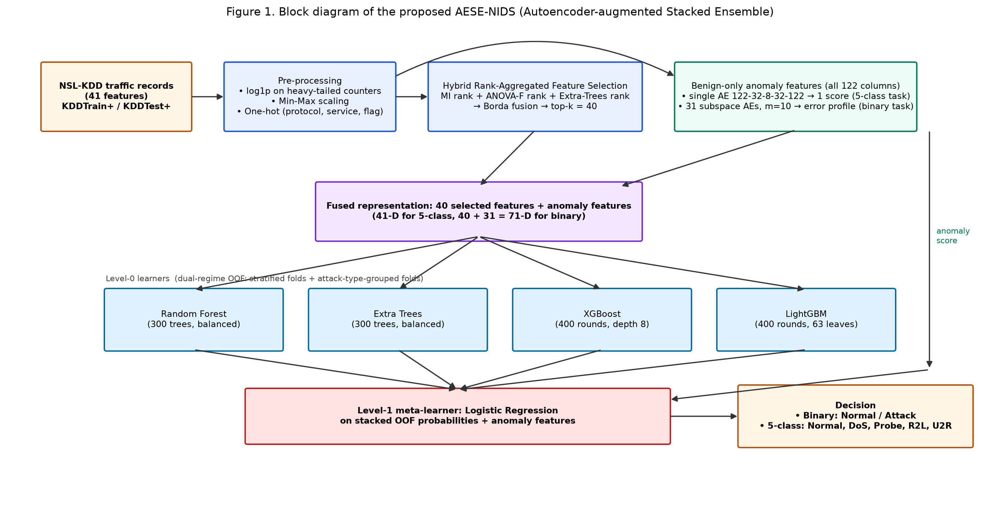
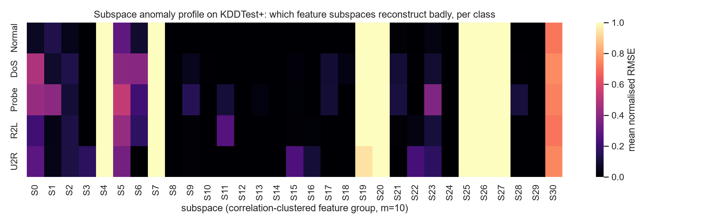
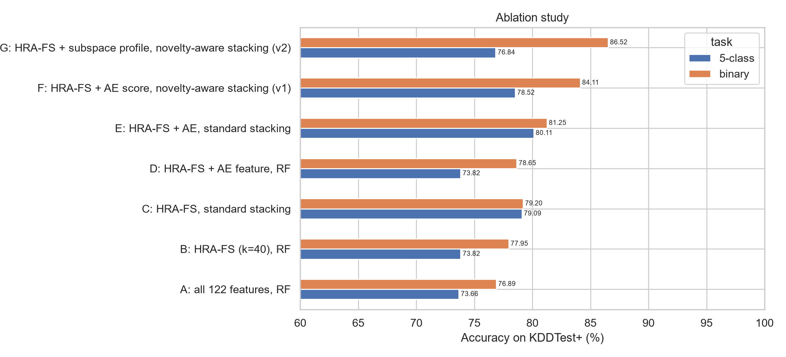

# Intelligent Network Intrusion Detection System

[](https://github.com/SayanMajhi/Intelligent-Network-Intrusion-Detection-System/actions/workflows/ci.yml)
[](https://www.python.org/downloads/)
[](LICENSE)
[](https://github.com/defcom17/NSL_KDD)

A machine-learning intrusion detector for network connection records, evaluated on the
official NSL-KDD train/test split. Benign-only autoencoders produce anomaly features,
and a stacked ensemble of four tree learners combines them through a logistic
meta-learner whose training set is built by holding out whole attack types. On
KDDTest+ the binary detector reaches **86.5% accuracy** and flags **79.6%** of records
from the 17 attack types absent from training; the best single tree baseline on the
same input reaches 79.8% and 41.2%.

<p align="center">
  
</p>

## Contents

1. [Method](#method)
2. [Results](#results)
3. [Repository layout](#repository-layout)
4. [Setup and execution](#setup-and-execution)
5. [Documentation](#documentation)
6. [Dataset](#dataset)
7. [Citation and license](#citation-and-license)

## Method

| Stage | Module | What it does |
|---|---|---|
| Preprocessing | `src/preprocessing.py` | log1p on 16 heavy-tailed counters, min-max scaling, one-hot protocol/service/flag. 41 attributes become 122 columns. Fitted on the training split only. |
| HRA-FS | `src/feature_selection.py` | Ranks every column by mutual information, ANOVA-F and Extra-Trees importance, fuses the three rankings with a Borda count, keeps 40. |
| Anomaly features | `src/autoencoder.py`, `src/subspace_autoencoder.py` | Trained on benign records only. A single 122-32-8-32-122 autoencoder gives one reconstruction-error score (used by the 5-class model). Thirty-one small autoencoders over correlation-clustered feature subspaces (Kitsune-style, m = 10) give a per-subspace error profile (used by the binary model). |
| Novelty-aware stacking | `src/models.py` | Random Forest, Extra Trees, XGBoost and LightGBM as level 0. Their out-of-fold probabilities are generated twice: with stratified folds, and with one fold per attack type. A logistic regression on [probabilities, anomaly features] is level 1. |

The attack-type-grouped folds are the point of the design. With ordinary stratified
folds the base learners are almost always right on the meta-training rows, so the
meta-learner ignores the anomaly features (weight 0.98 in the first version). Holding
out whole attack types gives it rows where the trees are confidently wrong and the
anomaly features are high, and it learns to defer to them (weight 5.3). Equations and
the two algorithms are in Section 3 of the [report](docs/report/REPORT.md).

<p align="center">
  
  <br><em>Mean per-subspace reconstruction error on KDDTest+. DoS and Probe break the traffic-count subspaces (S0, S5), U2R the shell/root subspace (S15), R2L the mail-service subspace (S11).</em>
</p>

## Results

All numbers are on the official KDDTest+ split, trained on KDDTrain+ only, seed 42.
Every baseline receives the same input matrix as the proposed model.

### Binary: Normal vs Attack

| Model | Accuracy | Detection rate | False-alarm rate | Unseen-attack detection |
|---|---|---|---|---|
| Random Forest | 77.2 | 62.1 | 2.7 | 26.4 |
| XGBoost | 79.8 | 66.7 | 2.8 | 41.2 |
| MLP (128-64) | 81.2 | 72.8 | 7.8 | - |
| Single autoencoder, unsupervised | 86.7 | 83.7 | 9.3 | - |
| Proposed, single AE score (v1) | 84.1 | 78.5 | 8.5 | 64.9 |
| **Proposed, subspace profile (v2)** | **86.5** | **83.0** | 8.8 | **79.6** |

"Unseen-attack detection" is the share of the 3,750 test records whose attack type never
occurs in training that the model flags.

### Five-class: Normal, DoS, Probe, R2L, U2R

78.5% accuracy, macro-F1 60.8, the highest macro-recall and macro-F1 of the compared
models. The five-class model keeps the single autoencoder score; the subspace profile
lowers its accuracy to 76.8% because the rare families have too few training rows for
31 extra meta-features.

### Ablation

<p align="center">
  
</p>

### Against published results on KDDTest+

| Method | Binary | 5-class |
|---|---|---|
| NB Tree, Tavallaee et al. 2009 | 82.0 | - |
| RNN-IDS, Yin et al. 2017 | 83.3 | 81.3 |
| Stacked NDAE + RF, Shone et al. 2018 | - | 85.4 |
| Self-taught learning, Javaid et al. 2016 | 88.4 | 79.1 |
| **This work** | **86.5** | 78.5 |

### Known limitations

Measured rather than hidden. On the hard KDDTest-21 subset the false-alarm rate is
38.7%. The v2 meta-learner's probabilities are saturated, so at a false-alarm budget of
1-2% the boosting baselines rank attacks better
([operating_points.csv](experiments/operating_points.csv), Section 4.10 of the report).
R2L recall stays low (41.7% binary) because most R2L test records are of unseen types
that look like ordinary SNMP or HTTP traffic at the connection-feature level.

## Repository layout

```
.
├── src/
│   ├── config.py                 paths, column names, attack-family map, hyper-parameters
│   ├── data_loader.py            reads NSL-KDD, adds binary and 5-class targets
│   ├── preprocessing.py          ColumnTransformer fitted on the training split only
│   ├── feature_selection.py      HRA-FS rank aggregation
│   ├── autoencoder.py            single benign-profile autoencoder
│   ├── subspace_autoencoder.py   KitNET-style subspace autoencoder ensemble
│   ├── models.py                 baselines and NoveltyAwareStacking
│   ├── evaluate.py               metrics and plots
│   ├── train.py                  full experiment: tables, figures, saved model
│   ├── compare.py                comparison with published NSL-KDD results
│   ├── predict.py                scores a CSV with the saved model
│   └── system_diagram.py         draws the block diagram
├── experiments/
│   ├── run_experiments.py        paper-inspired experiments E0-E7
│   ├── results.csv               one row per experiment run
│   ├── operating_points.csv      detection rate at fixed false-alarm budgets
│   └── kitnet_groups_m10.json    the 31 feature subspaces
├── results/tables/               metrics, ablation, per-class, KDDTest-21, meta weights
├── docs/
│   ├── report/                   REPORT.md, NIDS_Report.docx, figures/, build_docx.py
│   ├── notes/research_notes.md   design history: first version, papers, experiments, v2
│   └── papers/                   the three papers the experiments are based on
├── data/                         KDDTrain+.txt, KDDTest+.txt (NSL-KDD, 22 MB)
├── .github/workflows/ci.yml      compile, import, and a 5k-record end-to-end smoke fit
├── CITATION.cff
├── LICENSE
└── requirements.txt
```

`results/models/` (the trained pipeline, about 60 MB) is created by `train.py` and is
not tracked.

## Setup and execution

Python 3.10 or newer, CPU only, about 2 GB of RAM.

```bash
python -m venv .venv
.venv\Scripts\activate            # Windows; on Linux/macOS: source .venv/bin/activate
pip install -r requirements.txt
```

Reproduce every table and figure (about 45 minutes on a laptop CPU):

```bash
python src/train.py
python src/compare.py
```

Re-run the paper-inspired experiments (about one hour; appends to `experiments/results.csv`):

```bash
python experiments/run_experiments.py
```

Score new records with the saved model (NSL-KDD column format, label columns optional):

```bash
python src/predict.py data/KDDTest+.txt --out predictions.csv
```

Rebuild the Word report from `REPORT.md`:

```bash
python docs/report/build_docx.py
```

Hyper-parameters (number of selected features, autoencoder shape, subspace size, fold
count, seed) are in `src/config.py`. The seed is fixed; a run reproduces the numbers
above.

## Documentation

| Document | Contents |
|---|---|
| [docs/report/REPORT.md](docs/report/REPORT.md) / [NIDS_Report.docx](docs/report/NIDS_Report.docx) | Abstract, introduction, literature review, method with equations and algorithms, results (13 tables, 12 figures), comparison with prior work, conclusions, references, code listing |
| [docs/notes/research_notes.md](docs/notes/research_notes.md) | Working notes: why the first version underperformed, what each paper contributed, every experiment with its numbers, what was kept and what was dropped |
| [experiments/results.csv](experiments/results.csv) | One row per experiment run, including the KDDTest-21 scores |
| [docs/papers/](docs/papers/) | Tavallaee et al. 2009 (NSL-KDD), Shone et al. 2018 (stacked non-symmetric autoencoders), Mirsky et al. 2018 (Kitsune) |

## Dataset

NSL-KDD (Tavallaee et al., 2009): 41 connection features, 39 attack labels grouped into
DoS, Probe, R2L and U2R. KDDTrain+ has 125,973 records and KDDTest+ 22,544. KDDTest+
contains 17 attack types that do not occur in KDDTrain+ (3,750 records), and R2L is
three times more frequent in test than in train. The `difficulty` column, the number of
21 reference learners that classified a record correctly, defines the KDDTest-21 hard
subset. Files are in `data/`; source: [defcom17/NSL_KDD](https://github.com/defcom17/NSL_KDD).